```mermaid
%%{init: {
    "theme": "base",
    "themeVariables": {
        "background": "#F5F7FA",
        "primaryTextColor": "#1F2937",
        "lineColor": "#64748B",
        "fontFamily": "Arial"
    }
}}%%

flowchart TD

    %% ==========================================
    %% PUESTA EN MARCHA
    %% ==========================================

    A([Inicio]) --> B[Agente registra su institución]
    B --> C[Agente invita a sus docentes por correo]
    C --> D[Docente activa su cuenta por el enlace recibido]
    D --> E[Agente registra materias]
    E --> F[Asigna cada materia a un docente]

    %% ==========================================
    %% SOLICITUD
    %% ==========================================

    F --> G[Docente crea solicitud de clase espejo]
    G --> H[Selecciona materia, institución destino,<br/>objetivo y fecha propuesta]
    H --> I[Estado: Pendiente]

    %% ==========================================
    %% DOBLE REVISIÓN
    %% ==========================================

    I --> J{Agente de institución ORIGEN<br/>revisa la solicitud}
    I -. "nadie responde a tiempo" .-> C1[Estado: Caducada]
    C1 -. "reenviar con fecha nueva" .-> I

    J -->|Rechazar| K[Indica motivo]
    K --> L[Estado: Rechazada]
    L --> M{¿El docente corrige y reenvía?}
    M -->|Sí| I
    M -->|No| Z([Fin])

    J -->|Aprobar| N[Estado: Aprobada por origen]

    N -. "nadie confirma a tiempo" .-> C1

    N --> O{Agente de institución DESTINO<br/>revisa la solicitud}
    O -->|Rechazar| K
    O -->|Aprobar| P[Estado: Aprobada]

    %% ==========================================
    %% PROYECTO Y PLANIFICACIÓN
    %% ==========================================

    P --> Q[Se crea el proyecto de clase espejo]
    Q --> R[Docentes de ambas instituciones<br/>hacen la planificación conjunta]
    R --> S[Definen objetivos, temas, metodología,<br/>calendario y plataforma]
    S --> T[Cada docente confirma su participación]
    T --> U[Estado: En planificación]

    %% ==========================================
    %% EJECUCIÓN
    %% ==========================================

    U --> V[Estado: En curso]
    V --> W[Realizar la clase espejo conjunta]
    W --> X[Registrar sesiones, actividades y evidencias]

    X --> AA[Firmar el reporte de clase de cada sesión]

    AA --> AB{¿Hay más sesiones?}
    AB -->|Sí| W
    AB -->|No| AC[Registrar la evaluación final]

    %% ==========================================
    %% CIERRE
    %% ==========================================

    AC --> AD[Validar: evaluación final y<br/>reportes de sesión confirmados]
    AD --> AE[Estado: Finalizada]
    AE --> Z

    %% ==========================================
    %% ESTILOS
    %% ==========================================

    classDef inicioFin fill:#E2E8F0,stroke:#475569,color:#1E293B,stroke-width:3px
    classDef agente fill:#DBEAFE,stroke:#2563EB,color:#1E3A8A,stroke-width:3px
    classDef docente fill:#FEF3C7,stroke:#D97706,color:#78350F,stroke-width:3px
    classDef solicitud fill:#EDE9FE,stroke:#7C3AED,color:#4C1D95,stroke-width:3px
    classDef rechazo fill:#FEE2E2,stroke:#DC2626,color:#7F1D1D,stroke-width:3px
    classDef caducada fill:#FFF7ED,stroke:#F59E0B,color:#7C2D12,stroke-width:3px
    classDef aprobado fill:#DCFCE7,stroke:#16A34A,color:#14532D,stroke-width:3px
    classDef planeacion fill:#FFEDD5,stroke:#EA580C,color:#7C2D12,stroke-width:3px
    classDef ejecucion fill:#CCFBF1,stroke:#0D9488,color:#134E4A,stroke-width:3px
    classDef sistema fill:#F1F5F9,stroke:#64748B,color:#334155,stroke-width:2px

    class A,Z inicioFin
    class B,C,D,E,F,J,O agente
    class G,H,M,R,S,T,W,X,AA,AC docente
    class I,N,L solicitud
    class K rechazo
    class C1 caducada
    class P,Q,AE aprobado
    class R,S,U planeacion
    class V,W,X,AB ejecucion
    class AD sistema
```

> **Nota sobre la caducidad.** Las solicitudes que siguen en *Pendiente* (nadie
> respondió) o en *Aprobada por origen* (nadie confirmó) al cumplirse el plazo
> pasan a **Caducada** automáticamente. No las rechaza una institución: las
> cancela el sistema, y el docente puede reenviarlas con una fecha nueva.
