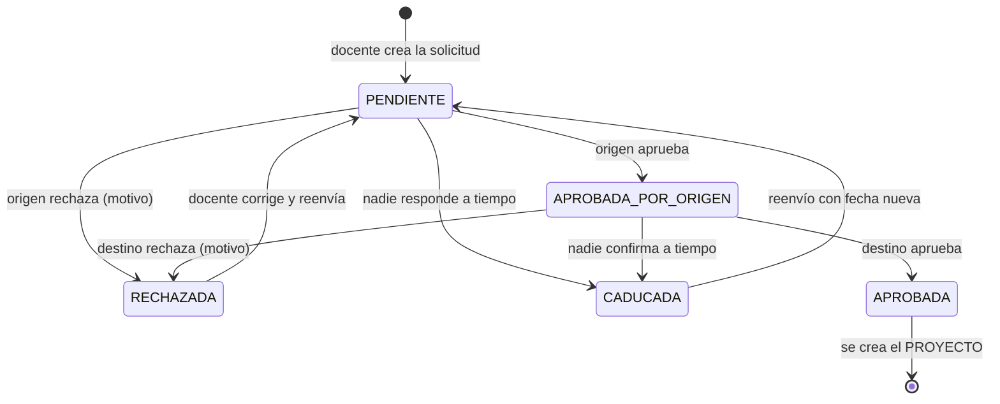
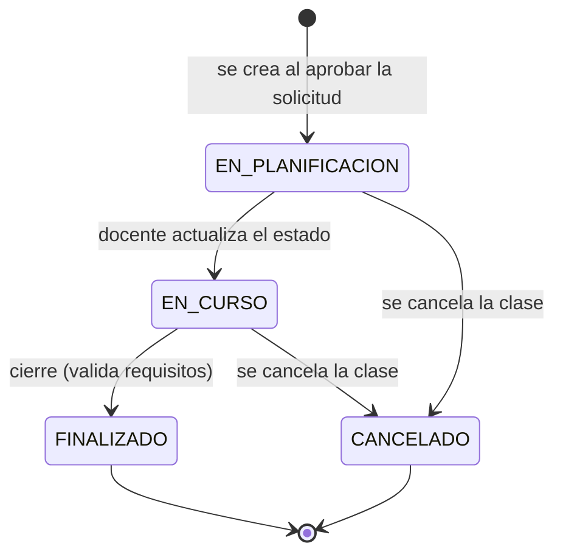
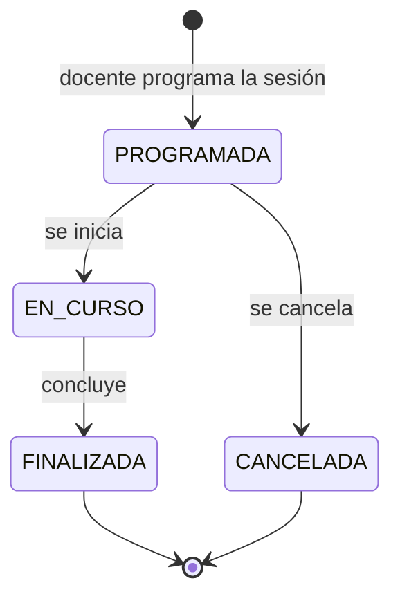
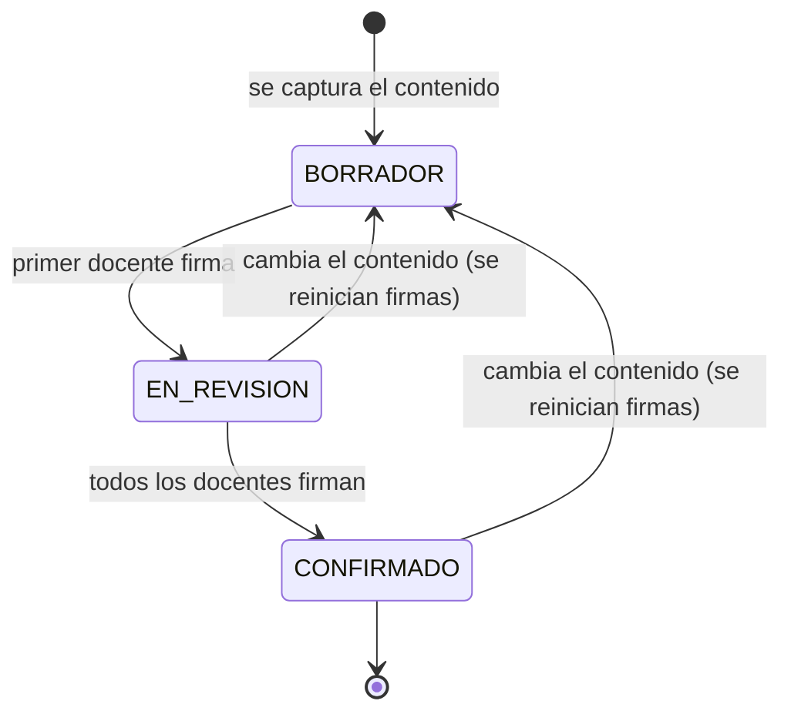
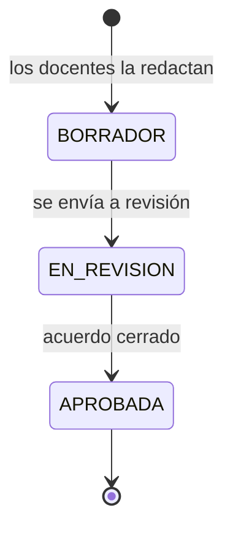
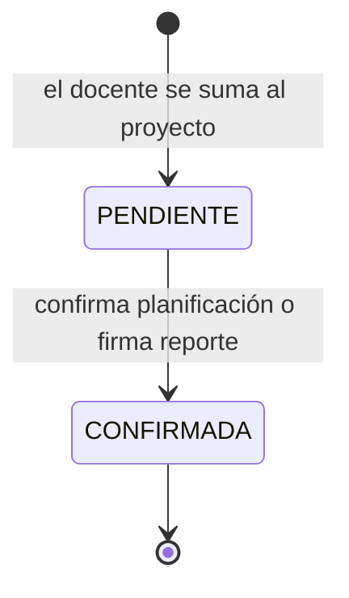

# 🔄 Diagrama de estados del sistema

Este documento reúne los **estados** de cada elemento del dominio y las
transiciones permitidas. Es la referencia visual de qué puede pasar de un estado
a otro y por qué.

> Fuente única de verdad en el código: `backend/src/common/estados.ts`.

---

## 1. Solicitud de clase espejo (doble revisión)

| Estado | Significado |
| --- | --- |
| **Pendiente** | Espera la primera revisión. |
| **Aprobada por origen** | La institución que propone ya aprobó; falta la de destino. |
| **Aprobada** | Ambas aprobaron; se creó el proyecto. |
| **Rechazada** | Alguna institución la rechazó (con motivo). |
| **Caducada** | Venció el plazo sin respuesta; la cancela el sistema. |

---

## 2. Proyecto (clase espejo)

> `FINALIZADO` **no** se fija a mano: solo lo asigna la acción **Cerrar clase
> espejo**, que exige al menos una evaluación final y que cada sesión (no
> cancelada) tenga su reporte confirmado.

---

## 3. Sesión

---

## 4. Reporte de clase (por sesión)

> Si el contenido del reporte cambia **después de firmado**, las firmas se
> reinician y el reporte vuelve a *Borrador*. Así una firma siempre corresponde
> al texto definitivo.

---

## 5. Planificación conjunta

---

## 6. Participaciones (confirmación)

> Aplica por igual a la **confirmación de participación** en la planificación y
> a las **firmas** del reporte de clase.
