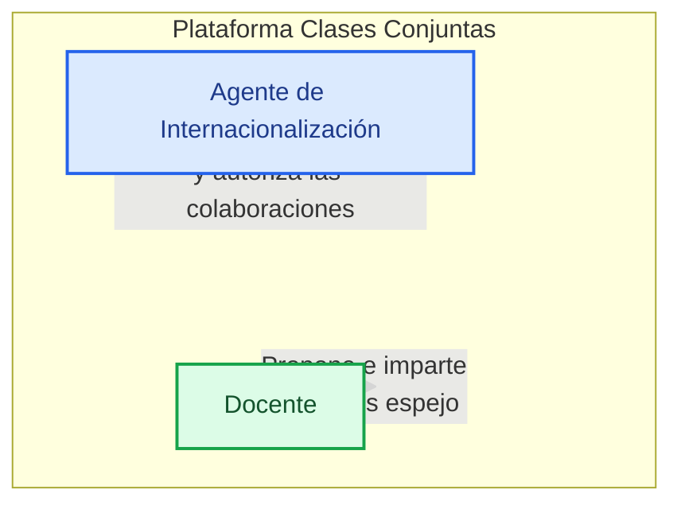
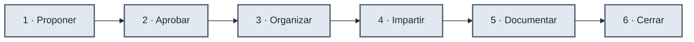
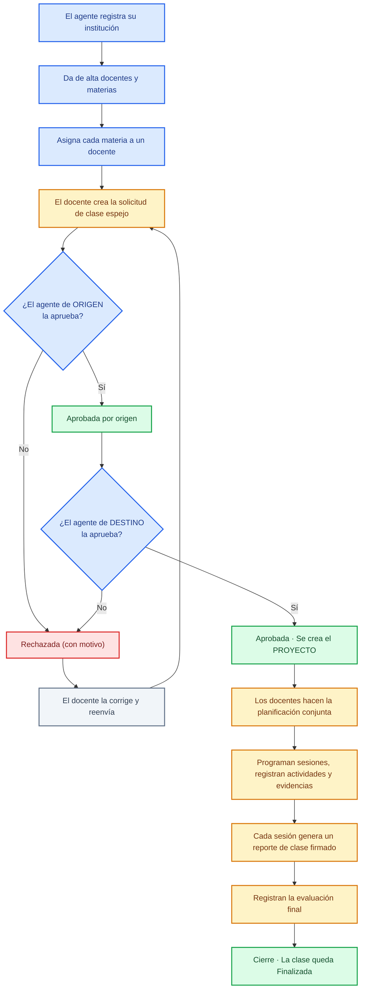
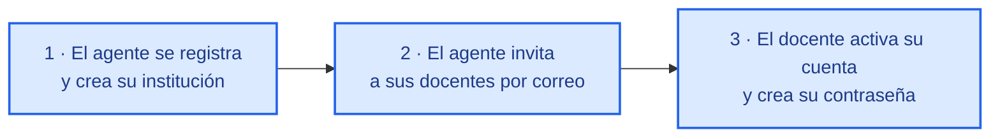
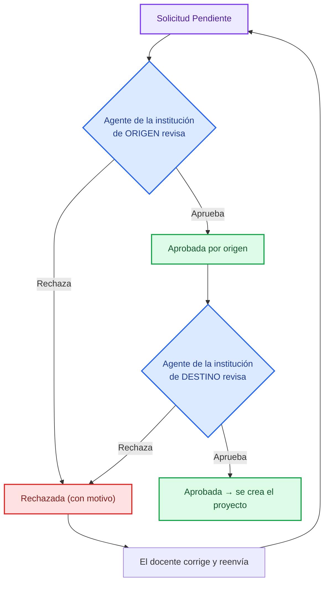
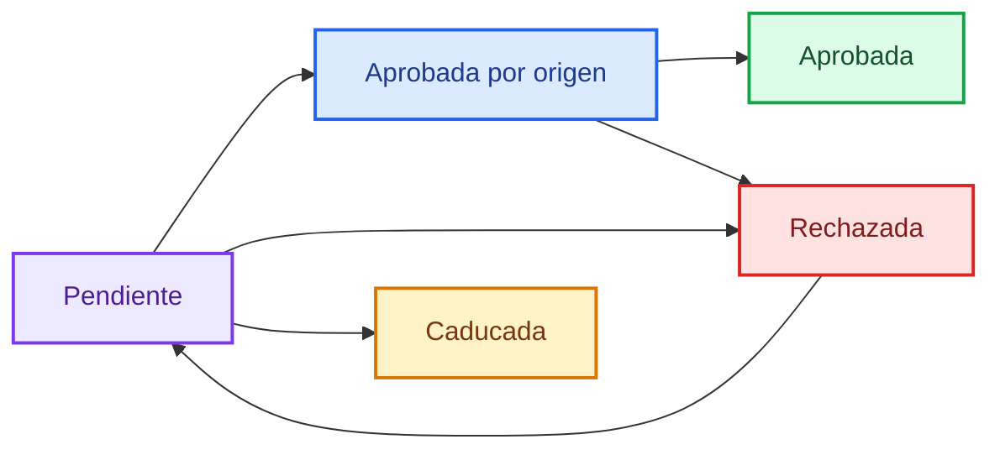
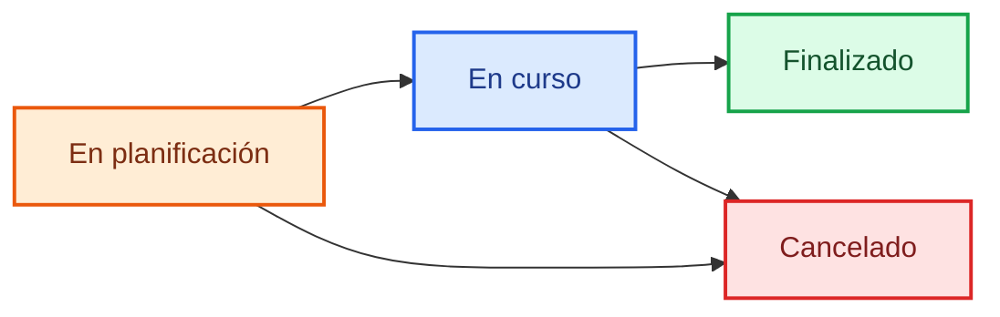

# 📘 Plataforma "Clases Conjuntas" — Informe para el cliente

**Comunidad de Apoyo a Clases Espejo (CACE)**
*"Uniendo mentes, corazones y proyectos."*

> Este documento está escrito para que cualquier persona —sin conocimientos de
> programación— entienda **qué hace la plataforma, para qué sirve cada función y
> cómo fluye el trabajo** de principio a fin. No habla de código, habla de
> resultados.

---

## Índice

1. [Qué es la plataforma](#1-qué-es-la-plataforma)
2. [El problema que resuelve](#2-el-problema-que-resuelve)
3. [Quiénes la usan y por qué](#3-quiénes-la-usan-y-por-qué)
4. [La idea central: el ciclo de vida de una clase espejo](#4-la-idea-central-el-ciclo-de-vida-de-una-clase-espejo)
5. [Cómo se entra al sistema](#5-cómo-se-entra-al-sistema)
6. [El flujo de trabajo paso a paso](#6-el-flujo-de-trabajo-paso-a-paso)
7. [Cada función y por qué existe](#7-cada-función-y-por-qué-existe)
8. [El calendario y los recordatorios](#8-el-calendario-y-los-recordatorios)
9. [Lo que protege el sistema](#9-lo-que-protege-el-sistema)
10. [Beneficios para su institución](#10-beneficios-para-su-institución)
11. [Estado actual y próximos pasos](#11-estado-actual-y-próximos-pasos)
12. [Glosario sencillo](#12-glosario-sencillo)
13. [Diagramas del sistema](#13-diagramas-del-sistema)

---

## 1. Qué es la plataforma

**"Clases Conjuntas"** es un sistema web para que **dos instituciones educativas
de distintos lugares (normalmente de países diferentes) organicen clases
conjuntas**, llamadas **clases espejo**.

En una clase espejo, **dos docentes de instituciones distintas imparten la misma
clase de forma coordinada**: acuerdan objetivos, temas y actividades, y sus
estudiantes participan en un mismo espacio virtual.

La plataforma acompaña todo ese proceso **desde la primera propuesta hasta el
cierre final**, guardando cada paso de forma ordenada:

| Etapa | Qué responde |
| --- | --- |
| **Proponer** | Un docente propone una clase con otra institución. |
| **Aprobar** | Dos responsables institucionales la revisan y aprueban. |
| **Organizar** | Los docentes acuerdan cómo será la clase. |
| **Impartir** | Se registran las sesiones, actividades y evidencias. |
| **Documentar** | Se firman reportes de cada sesión. |
| **Cerrar** | Se evalúa la experiencia y se guarda el historial. |

En una frase: **una sola herramienta que ordena, supervisa y deja constancia de
todas las clases espejo de una institución.**

---

## 2. El problema que resuelve

Antes de este tipo de sistemas, una clase espejo entre dos instituciones suele
depender de **correos, mensajes y hojas sueltas**, lo que provoca:

- ❌ No saber **en qué estado** está cada propuesta (¿la aprobaron? ¿quién falta?).
- ❌ **Propuestas olvidadas** que nadie respondió a tiempo.
- ❌ **Acuerdos de palabra** que después nadie recuerda.
- ❌ **Reportes y evidencias dispersos** en bandejas de correo.
- ❌ No poder **demostrar** qué se hizo, cuándo y quién lo firmó.

La plataforma lo resuelve al imponer un **orden claro y un registro formal**:

- ✅ Cada propuesta tiene un **estado visible** en todo momento.
- ✅ Las aprobaciones quedan **firmadas por responsable y con motivo**.
- ✅ Si nadie responde a tiempo, el sistema **avisa y hasta vence la solicitud sola**.
- ✅ Las clases terminadas quedan como **historial consultable**, no se borran.
- ✅ Todo lo importante (reportes, firmas, evidencias) se guarda **en un solo lugar**.

---

## 3. Quiénes la usan y por qué

Solo hay **dos tipos de usuario**, y cada uno tiene un papel claro. Esta
separación es la clave del orden: **cada quien hace lo suyo y el sistema se
encarga de que nadie se pise.**

### 👔 Agente de internacionalización

Es el **responsable institucional** de la colaboración internacional.

- Registra y mantiene los **datos de la institución**.
- Da de alta y gestiona a los **docentes**.
- Da de alta las **materias** y decide **quién imparte qué**.
- **Revisa y aprueba (o rechaza)** las propuestas de clase espejo.
- **Supervisa** las clases de su institución (las ve completas, pero no las organiza).

> **Por qué existe:** garantiza que ninguna colaboración internacional se haga "por
> fuera" del control de la institución, y que cada propuesta pase por una revisión
> formal.

### 🧑‍🏫 Docente

Es quien **imparte** la clase.

- **Propone** clases espejo con otras instituciones.
- **Organiza** la clase aprobada: planificación, sesiones, actividades, evidencias.
- **Firma** los reportes de clase.
- **Evalúa y cierra** la clase espejo.

> **Por qué existe:** es el especialista del contenido. El sistema le da todo lo
> que necesita para organizar la clase y, al mismo tiempo, lo deja dentro del
> marco que la institución aprobó.

**La regla de oro:** el agente **no organiza la clase** (no crea sesiones ni
reportes) y el docente **no administra la institución** (no crea materias ni
aprueba solicitudes). Cada rol tiene sus funciones y el sistema las hace respetar.

---

## 4. La idea central: el ciclo de vida de una clase espejo

Toda clase espejo pasa por el **mismo camino de seis estaciones**. Pensar en estas
seis etapas ayuda a entender cualquier pantalla del sistema:

| # | Etapa | Qué ocurre | Quién |
| --- | --- | --- | --- |
| 1 | **Proponer** | Un docente crea una solicitud con la materia, la institución destino, el objetivo y una fecha. | Docente |
| 2 | **Aprobar** | Dos agentes la revisan: primero el de la institución que propone y luego el de la que recibe. | Agentes |
| 3 | **Organizar** | Se crea el "proyecto" y los docentes acuerdan objetivos, temas, metodología y plataforma. | Docentes |
| 4 | **Impartir** | Se programan sesiones y se registran actividades y evidencias. | Docentes |
| 5 | **Documentar** | Cada sesión genera un reporte de clase que los docentes firman. | Docentes |
| 6 | **Cerrar** | Se registra una evaluación final y la clase queda "Finalizada" como historial. | Docentes |

El siguiente diagrama muestra **el recorrido completo** con los dos puntos de
control (revisión de origen y de destino):

> **Nota clave:** si en algún punto de la doble revisión se rechaza, **el docente
> corrige y la propuesta vuelve a empezar** el camino de aprobación. El sistema
> nunca deja una propuesta "a medias" sin que se sepa por qué.

---

## 5. Cómo se entra al sistema

El alta se hace en **tres pasos** para que nadie quede registrado sin el permiso
de su institución:

| Paso | Quién | Qué hace | Por qué |
| --- | --- | --- | --- |
| **1. Registro** | Agente | Se registra con sus datos y los de su institución. | La institución queda identificada con sus datos oficiales. |
| **2. Invitación** | Agente | Invita a cada docente **por correo** con un enlace único. | Los docentes **no se auto-registran**: solo entra quien la institución invita. |
| **3. Activación** | Docente | Abre el enlace y crea su propia contraseña. | El enlace es **de un solo uso y caduca**; así se evita que se reutilice. |

- Mientras a la institución le falten datos obligatorios, el sistema **bloquea el
  panel con un aviso** ("Completa el registro de tu institución"). Es el
  **gate de institución**: garantiza que ninguna institución opere con datos
  incompletos, que son su carta de presentación ante las demás.
- Si un docente es **desactivado**, deja de poder entrar pero **su historial se
  conserva**; si es **eliminado**, solo se permite cuando ya no tiene
  participaciones que proteger.

---

## 6. El flujo de trabajo paso a paso

### 6.1 El docente propone una clase espejo

Desde su panel, el docente pulsa **Nueva solicitud** y completa:

- **Materia de origen** — solo aparecen las materias que tiene asignadas.
- **Institución destino** — solo aparecen instituciones con su registro completo.
- **Título y objetivo** — qué se busca lograr.
- **Fecha propuesta** — debe ser futura.

Al guardar, la solicitud queda en estado **Pendiente**.

> **Por qué importa:** el sistema solo deja proponer clases sobre **materias
> realmente asignadas** al docente y con **instituciones válidas**, de modo que
> las propuestas siempre llegan con datos correctos.

### 6.2 La doble revisión (el control de calidad)

Aquí está el corazón del sistema: **ninguna clase espejo nace sin que dos
responsables la aprueben.**

| Momento | Quién decide | Si aprueba | Si rechaza |
| --- | --- | --- | --- |
| **1.ª revisión** | Agente de **origen** (el que propone) | Pasa a "Aprobada por origen" y viaja al destino. | Queda "Rechazada" con el motivo. |
| **2.ª revisión** | Agente de **destino** (el que recibe) | Queda "Aprobada" y **se crea el proyecto** automáticamente. | Queda "Rechazada" con el motivo. |

- Al rechazar, el agente **debe escribir el motivo**: el docente lo verá y sabrá
  exactamente qué corregir.
- Al corregir y reenviar, la solicitud **vuelve a Pendiente** y el ciclo se repite.
- El botón **"Revisar"** solo aparece cuando **le toca** a esa institución: la
  plataforma controla en qué etapa está cada solicitud.

### 6.3 Nace el proyecto y se organiza la clase

Cuando el destino aprueba, el sistema **crea el proyecto automáticamente**. Ya no
es una propuesta: es una clase en marcha, y se abre una pantalla con todo lo
necesario para organizarla (datos, planificación, sesiones, chat, evidencias…).

### 6.4 Se imparte, se documenta y se cierra

Los docentes programan sesiones, registran actividades, suben evidencias, firman
el reporte de cada sesión y, al final, registran la evaluación y cierran la clase.

---

## 7. Cada función y por qué existe

Aquí está el detalle de **todas las funciones**, agrupadas por área, con su razón
de ser en lenguaje sencillo.

### 7.1 Panel del agente

| Función | Qué hace | Por qué existe (valor para el cliente) |
| --- | --- | --- |
| **Mi institución** | Ver y editar los datos oficiales de la institución. | Los datos correctos son la carta de presentación: las demás instituciones los ven al recibir propuestas. |
| **Docentes** | Invitar, activar, desactivar y eliminar docentes. | La institución controla **quién** puede entrar y actuar, sin perder el historial al dar de baja a alguien. |
| **Materias** | Dar de alta, editar y eliminar materias. | Sin materias registradas no hay clases espejo; son el catálogo base. |
| **Asignaciones** | Vincular cada materia a un docente y un periodo. | Es el "permiso" que habilita a un docente a proponer clases con esa materia. Sin asignación no se puede proponer. |
| **Solicitudes (revisión)** | Ver las propuestas en un tablero de 3 columnas y aprobar/rechazar con motivo. | Es el **control de calidad institucional**: ninguna colaboración avanza sin revisión formal. |
| **Proyectos** | Ver las clases de la institución en planificación, en curso, finalizadas o canceladas. | Supervisión de un vistazo de todo lo que está pasando. |
| **Agregar/quitar docentes** | Dentro de un proyecto, añadir o retirar docentes de **su propia institución**. | Permite sumar un co-docente cuando la clase lo requiere, sin tocar a la otra institución. |
| **Reporte de planificación** | El agente documenta acuerdos, calendario y actividades acordadas. | Es su **mecanismo de supervisión**: deja constancia oficial de lo planificado. |

### 7.2 Panel del docente

| Función | Qué hace | Por qué existe |
| --- | --- | --- |
| **Nueva solicitud** | Crear una propuesta de clase espejo. | Es el punto de entrada de toda colaboración. |
| **Mis solicitudes** | Ver el estado de cada propuesta (pendiente, aprobada, rechazada, caducada). | El docente siempre sabe en qué etapa está su trabajo. |
| **Corregir y reenviar** | Editar una propuesta rechazada para volver a enviarla. | El rechazo no es el final: es una guía para mejorar y reintentar. |
| **Mis proyectos** | Ver sus clases en planificación, en curso, finalizadas o canceladas. | Acceso directo a todo su trabajo. |

### 7.3 Dentro de la clase espejo (el "proyecto")

| Función | Qué hace | Por qué existe |
| --- | --- | --- |
| **Datos del proyecto** | Fechas, plataforma (Zoom, Teams, Meet…) y estado. | Define **cuándo y dónde** se impartirá la clase. |
| **Planificación conjunta** | Acordar objetivos, temas, metodología y plataforma. | Es el **acuerdo pedagógico** que sostiene toda la clase; sin él no hay rumbo común. |
| **Confirmación de participación** | Cada docente confirma su participación. | Deja constancia de que **todos** están de acuerdo con lo planeado. |
| **Chat del proyecto** | Conversación entre los docentes del proyecto. | Coordinarse **sin salir de la plataforma**, y que la conversación quede guardada como historial. |
| **Sesiones** | Programar cada encuentro virtual (fecha, hora, enlace). | Organiza el calendario real de la clase. |
| **Actividades** | Registrar tareas con instrucciones y fecha límite. | Deja claro qué deben hacer los estudiantes (o docentes) entre sesiones. |
| **Evidencias** | Subir archivos (fotos, actas, videos, documentos). | **Respalda** el trabajo realizado con pruebas que quedan guardadas. |
| **Reporte de clase** | Registrar cómo fue cada sesión (desarrollo, asistentes, incidencias, acuerdos). | Es el **registro formal** de lo ocurrido, necesario para poder cerrar la clase. |
| **Firmas del reporte** | Cada docente firma con sus observaciones. | Garantiza que **todos respaldan** el reporte; si el texto cambia, las firmas se reinician (nadie firma algo que ya cambió). |
| **Evaluación final** | Registrar el instrumento y el resultado de la experiencia. | Cierra el ciclo con una **valoración** de lo logrado. |
| **Cierre de la clase** | Pasa el proyecto a "Finalizado" (solo lectura). | Deja la clase como **historial consultable** y garantiza que nada quedó pendiente. |

### 7.4 Los estados (para leer cualquier pantalla)

Cada elemento tiene un **estado** visible que dice exactamente dónde está:

**Solicitud de clase espejo**

| Estado | Significado sencillo |
| --- | --- |
| **Pendiente** | Esperando la primera revisión. |
| **Aprobada por origen** | Tu institución ya aprobó; falta la otra. |
| **Aprobada** | Ambas aprobaron; se creó el proyecto. |
| **Rechazada** | Alguna institución la rechazó (verás el motivo). |
| **Caducada** | Nadie respondió a tiempo; la cancela el sistema (se puede reenviar con fecha nueva). |

**Proyecto (clase espejo)**

| Estado | Significado sencillo |
| --- | --- |
| **En planificación** | Los docentes están acordando cómo será la clase. |
| **En curso** | La clase ya se está impartiendo. |
| **Finalizado** | Cerrada formalmente; queda como historial en solo lectura. |
| **Cancelado** | No se llevó a cabo. |

---

## 8. El calendario y los recordatorios

Para que **nada se quede en el olvido**, el sistema incluye una agenda y avisos
automáticos:

| Elemento | Qué hace | Por qué existe |
| --- | --- | --- |
| **Calendario mensual** | Ventana con el mes: sesiones programadas (azul) y vencimientos de solicitudes (ámbar/rojo). | Ver de un vistazo **todo lo que viene**. |
| **"Lo próximo"** | Sesiones y vencimientos ordenados por fecha. | Saber qué toca **más pronto**. |
| **"Por hacer"** | Lo que falta de tu parte (reportes sin firmar, tareas, evaluaciones…). | Saber qué **te falta a ti**. |
| **Marcas de urgencia** | "vence hoy", "vence en 2 días", "vencida". | Priorizar: **crítico** (2 días o menos), **próximo** (hasta 7), **vencido**. |
| **Caducidad automática** | Una solicitud sin respuesta se cancela sola al llegar su plazo. | Nadie se queda esperando para siempre; la propuesta se puede reenviar con fecha nueva. |

> **El valor real:** el docente ve una lista de "pendientes de la semana" en lugar
> de buscar entre muchas tarjetas; y el agente ve de inmediato qué solicitudes
> esperan su decisión.

---

## 9. Lo que protege el sistema

La plataforma cuida **la información y la integridad del historial**, en lenguaje
sencillo:

- **Acceso seguro:** contraseñas nunca guardadas tal cual (se cifran), sesión que
  caduca sola y bloqueo temporal tras varios intentos fallidos.
- **Cada quien lo suyo:** un agente solo ve y gestiona **su institución**; un
  docente solo accede a los proyectos donde participa.
- **Nada se borra a lo tonto:** no se puede eliminar una materia, un docente, una
  sesión o un docente de proyecto si ya tienen historial asociado. El sistema
  avisa el motivo exacto.
- **Archivos controlados:** las evidencias aceptan solo formatos seguros (PDF,
  imágenes, documentos, texto y ZIP) y se **descargan** en vez de abrirse dentro
  de la app, para evitar código malicioso.
- **Firmas que valen:** si un reporte ya firmado cambia de contenido, las firmas
  se reinician. Así una firma siempre corresponde al texto final.
- **Cierre con candado:** no se puede cerrar una clase sin su **evaluación final**
  y sin que **cada sesión tenga su reporte firmado**. El sistema dice exactamente
  qué falta.

---

## 10. Beneficios para su institución

| Beneficio | En qué se traduce |
| --- | --- |
| **Orden y claridad** | Cada propuesta, clase y tarea tiene un estado visible. |
| **Control institucional** | Las colaboraciones pasan por revisión formal; nadie opera "por fuera". |
| **Trazabilidad** | Queda constancia de quién aprobó, quién firmó y qué se hizo. |
| **Nada se pierde** | Evidencias, reportes y acuerdos en un solo lugar, con historial. |
| **Cumplimiento de plazos** | Recordatorios y caducidad automática evitan propuestas olvidadas. |
| **Profesionalismo** | Los datos correctos y el registro formal proyectan una institución seria ante sus pares. |

---

## 11. Estado actual y próximos pasos

La plataforma está **funcional de principio a fin**: el ciclo completo (de
registro de institución a cierre de la clase espejo) está implementado y ha pasado
**tres rondas de revisión de calidad** (código, experiencia de uso y
accesibilidad).

| Área | Estado |
| --- | --- |
| Registro, invitación y activación | ✅ Completo |
| Gestión de institución, docentes, materias y asignaciones | ✅ Completo |
| Solicitudes y doble revisión | ✅ Completo |
| Proyecto, planificación, chat, sesiones, actividades y evidencias | ✅ Completo |
| Reportes firmados, evaluación y cierre | ✅ Completo |
| Calendario y recordatorios | ✅ Completo |
| Recuperación de contraseña ("olvidé mi contraseña") | ⏳ Pendiente (hoy se gestiona a través del agente) |
| Prueba integral sobre la versión final y despliegue | ⏳ Pendiente |

---

## 12. Glosario sencillo

| Término | Significado |
| --- | --- |
| **Clase espejo** | Clase impartida conjuntamente por docentes de dos instituciones. |
| **Institución de origen** | La que propone la clase. |
| **Institución de destino** | La que recibe y acepta la propuesta. |
| **Agente de internacionalización** | Responsable institucional de la colaboración internacional. |
| **Docente** | Quien imparte la clase. |
| **Solicitud** | Propuesta formal de clase espejo entre dos instituciones. |
| **Proyecto** | Clase espejo ya aprobada, en ejecución. |
| **Planificación conjunta** | Acuerdo de objetivos, temas, metodología y calendario. |
| **Sesión** | Encuentro virtual programado de la clase. |
| **Reporte de clase** | Registro de lo ocurrido en una sesión, firmado por los docentes. |
| **Evidencia** | Archivo que respalda el trabajo realizado. |
| **Evaluación final** | Valoración de la experiencia al terminar. |
| **Cierre** | Paso final que marca la clase como "Finalizada". |
| **Asignación** | Vínculo docente ↔ materia dentro de un periodo. |
| **CACE** | Comunidad de Apoyo a Clases Espejo. |

---

## 13. Diagramas del sistema

Este informe incluye sus propios diagramas en cada sección. Además, los diagramas
**técnicos editables** del proyecto viven en la carpeta `docs/diagramas/` y se
mantienen alineados con el sistema actual:

| Archivo | Qué muestra |
| --- | --- |
| `diagrama de flujo.md` | El recorrido completo de una clase espejo (incluye caducidad). |
| `casos_de_uso.md` | Qué puede hacer cada rol (agente y docente). |
| `diagrama_de_secuencias.md` | Cómo se registran, invitan y activan los usuarios. |
| `entidad_relacion.md` | El modelo de datos completo (22 tablas y sus vínculos). |
| `estados.md` | Todos los estados y sus transiciones (solicitud, proyecto, sesión, reporte, planificación). |

> Estos diagramas usan **Mermaid** y pueden verse en GitHub, VS Code, Obsidian o
> cualquier visor compatible. Son la fuente técnica de la que se deriva este
> informe para el cliente.

---

*Informe de la plataforma "Clases Conjuntas" · Comunidad de Apoyo a Clases Espejo (CACE).*
*Documento orientado a clientes, sin tecnicismos. Los diagramas pueden verse en
cualquier visor compatible con Mermaid.*
