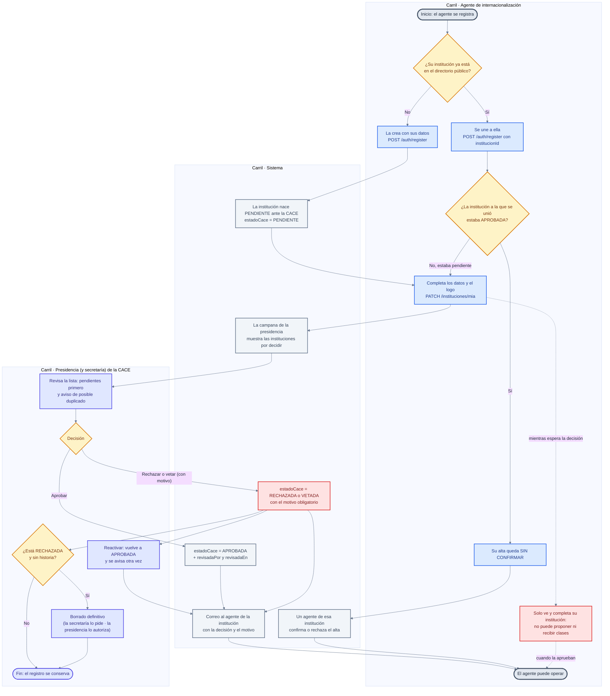
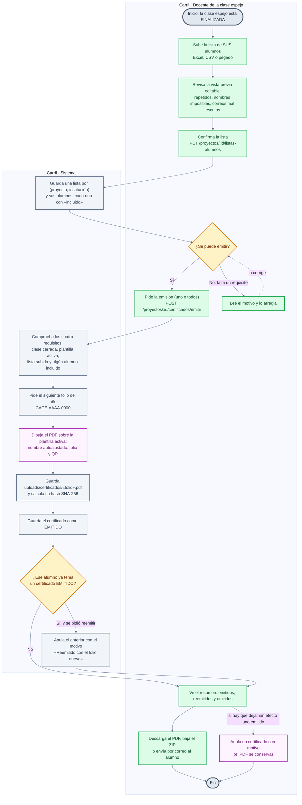
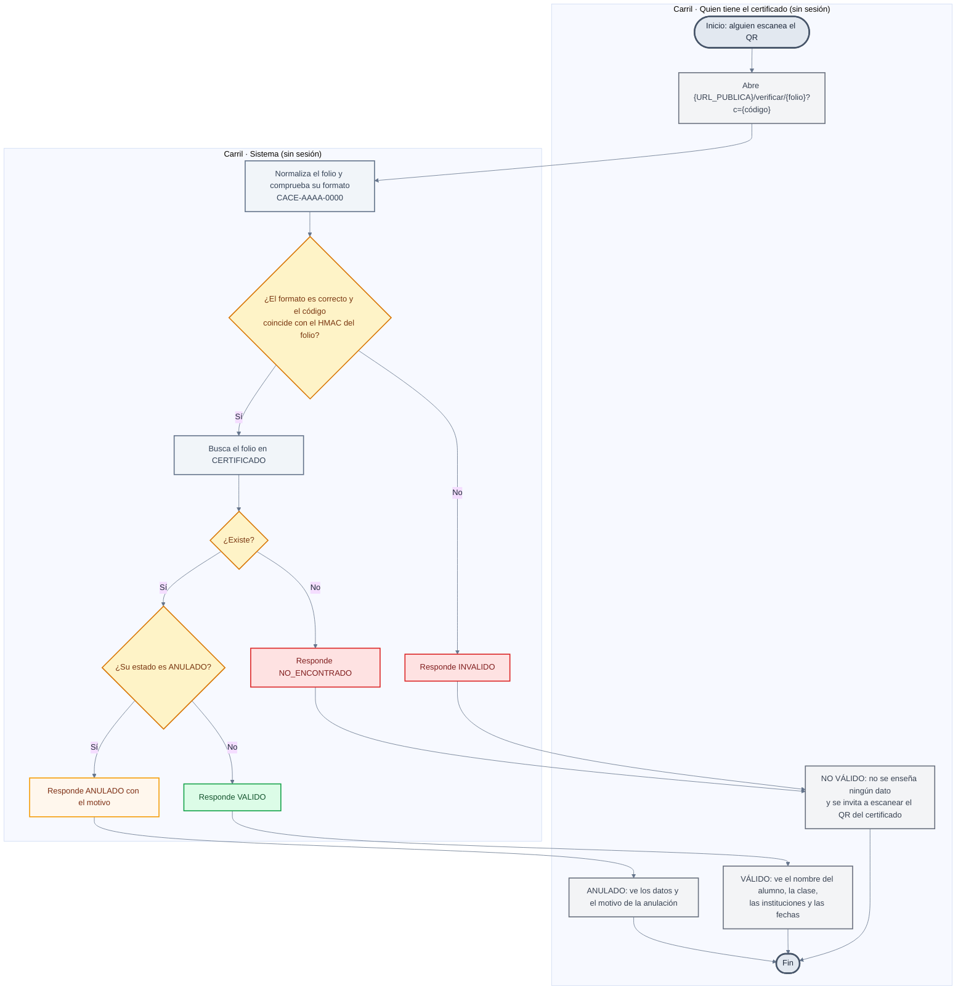
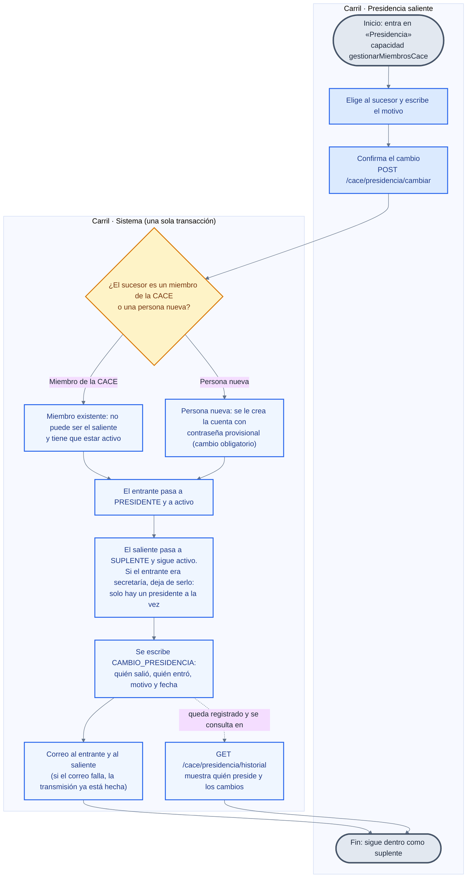

# 🔀 Diagramas de actividad

Los procesos clave, paso a paso: **quién hace qué** y **en qué orden**, con los
puntos de decisión y sus resultados. Mermaid no tiene un diagrama de actividad
formal, así que se representan con `flowchart` y **subgrafos usados como
carriles** (*swimlanes*): cada subgrafo es quien actúa.

> Las fuentes de cada diagrama están citadas en su apartado. Los estados que
> aparecen son los de `backend/src/common/estados.ts`, dibujados en
> [`estados.md`](estados.md); aquí se ve **cómo se llega** a cada uno.

---

## 1. Aprobación de una institución

Del registro del agente a la decisión de la CACE y sus avisos. Incluye las dos
puertas que tiene una institución: la **decisión de la presidencia** cuando es
nueva o está pendiente, y la **confirmación del alta por un agente de la propia
institución** cuando alguien se une a una ya aprobada.

> Fuentes: `backend/src/cace/instituciones-cace.service.ts` (aprobar, rechazar,
> vetar, reactivar, borrado con autorización y avisos por correo),
> `backend/src/auth/auth.service.ts` (registro y `requiereConfirmacion`) y
> `backend/src/agentes/agentes.service.ts` (confirmaciones de alta).

**Notas**

* **Completar los datos es la única salida mientras está pendiente.** El
  «gate» de institución deja al agente de una institución no aprobada ver y
  completar `Mi institución` y nada más: ni catálogo, ni solicitudes, ni clases.
* **El motivo es obligatorio al rechazar y al vetar**, y viaja en el correo al
  agente. Aprobar o reactivar también se avisa: la institución pudo dar por
  perdida su alta.
* **El veto es la decisión más grave** y no se hace público: se avisa solo a la
  institución afectada. Las clases ya en curso siguen vivas.
* **Un solo camino borra.** El borrado definitivo exige que la institución esté
  **rechazada y sin historia** (sin clases, revisiones ni dependencias); la
  presidencia lo hace directo y la secretaría solo puede **pedirlo**, y la
  presidencia autoriza (al aprobar, el borrado se ejecuta).
* La institución **no se desaprueba sola**: `activa` (el apagado operativo) es
  otra cosa y no se toca desde este proceso.

---

## 2. Emisión de un certificado

De la lista de alumnos al PDF con folio y QR, y de ahí a la descarga o al correo.
La emisión tiene **cuatro requisitos** y el sistema dice cuál falta.

> Fuentes: `backend/src/proyectos/listas-alumnos.service.ts` (subida y vista
> previa), `backend/src/certificados/certificados.service.ts` (emisión,
> reemisión, anulación, ZIP y envío) y
> `backend/src/certificados/certificado-pdf.service.ts` (el PDF, el QR y el
> autoajuste del nombre). El cierre de la clase que hace falta antes está en
> `backend/src/proyectos/proyectos.service.ts` (`cerrarProyecto`).

**Notas**

* **Los cuatro requisitos, en orden de comprobación:** la clase tiene que estar
  `FINALIZADO`; tiene que haber una **plantilla activa** diseñada por la
  presidencia; el docente tiene que haber subido **su** lista; y tiene que haber
  **al menos un alumno incluido**. Si falta alguno, la pantalla explica cuál y
  el botón queda deshabilitado.
* **Cerrar la clase es otro proceso.** `POST /proyectos/:id/cerrar` exige una
  **evaluación final** registrada y que **cada sesión no cancelada** tenga su
  reporte de clase `CONFIRMADO` (las firmas de los docentes). Sin eso no hay
  emisión posible.
* **Cada docente emite para los alumnos de su institución**, nunca para los de la
  otra: la lista se busca por (proyecto, institución).
* **El folio se pide antes de generar** porque va impreso dentro del PDF. El
  PDF se guarda tal como salió, con su `hashSha256`; cambiar la plantilla después
  **no** lo altera.
* **Reemitir no borra nada**: se anula el anterior con el motivo «Reemitido con
  el folio nuevo» y el nuevo queda vigente. Un alumno no puede tener dos
  certificados vigentes del mismo curso.
* **La anulación** la puede hacer el docente de esa clase (para los certificados
  de su institución) o la presidencia (para cualquiera, desde su panel). El PDF
  no se borra: la página pública pasa a mostrarlo como anulado con el motivo.
* **El QR no lleva solo el folio**: lleva también el código de verificación
  (`/verificar/{folio}?c={código}`), que se deriva del folio con un HMAC. El
  folio es consecutivo y se adivina; el código, no.
* **El ZIP no incluye los anulados**: es lo que se entrega a los alumnos.

---

## 3. Verificación pública

Lo que ocurre cuando alguien escanea el QR impreso en un certificado. Es el
único proceso que se ejecuta **sin cuenta y sin sesión**.

> Fuentes: `backend/src/certificados/verificacion.service.ts` (los cuatro
> desenlaces), `backend/src/certificados/codigo-verificacion.ts` (el HMAC, el
> formato del folio y la comparación en tiempo constante) y
> `frontend/src/app/features/verificacion/` (la pantalla).

**Notas**

* **El código se comprueba antes de tocar la base.** Si el enlace no trae el
  código o trae uno que no encaja, la respuesta es `INVALIDO` **sin consultar**:
  no se puede averiguar qué folios existen probando números.
* **Los cuatro desenlaces son los del servicio**: `VALIDO`, `ANULADO`,
  `NO_ENCONTRADO` e `INVALIDO`. En pantalla, «no encontrado» e «inválido» se
  presentan como **no válido** y ninguno de los dos enseña dato alguno del
  alumno; la diferencia está en el texto que se lee.
* **Un certificado anulado se enseña como anulado, no como falso**: quien
  escanea el QR de un anulado tiene que entender que ya no vale, con su motivo.
* **Siempre responde `200` con un estado**, y no hay ninguna ruta que liste
  certificados. Lo que se muestra es solo el nombre del alumno y los datos de la
  clase: nunca la matrícula, el correo, el hash ni el PDF.
* **El código no está guardado en ninguna columna**: se deriva del folio. Por eso
  los certificados emitidos antes de que existiera la verificación también
  funcionan.

---

## 4. Transmisión de la presidencia

La presidencia de la CACE **no se borra ni se desactiva: se transmite**. Quien
deja el cargo queda como suplente, con las mismas capacidades.

> Fuentes: `backend/src/cace/presidencia-cace.service.ts` (el cambio, la
> transacción, los avisos y el historial), `backend/src/common/capacidades.ts`
> (suplencia y presidencia comparten rol) y `backend/src/cace/miembros-cace.service.ts`
> (altas de secretarías).

**Notas**

* **Todo pasa en una transacción.** Un cambio de presidencia a medias dejaría a
  la CACE sin nadie que pueda aprobar instituciones, autorizar borrados o firmar
  certificados.
* **El suplente no pierde nada**: conserva las capacidades, porque el rol se
  resuelve por relación y presidencia y suplencia se tratan igual
  (`backend/src/common/capacidades.ts`).
* **Solo hay un presidente a la vez.** Si apareciera otra fila con cargo
  `PRESIDENTE`, el cambio la baja a suplencia.
* **El cargo manda**: si el sucesor era secretaría, deja de serlo; la interfaz lo
  avisa antes de confirmar.
* **Un correo que no sale no deshace la transmisión**: queda hecha, escrita en el
  historial y dicha en la respuesta. Si el entrante es nuevo y el correo falla,
  la contraseña provisional viaja en la respuesta para dársela a mano.
* La presidencia se crea sola **al arrancar el servidor** si no existe ninguna y
  hay `PRESIDENTE_CORREO` (con cambio de contraseña obligatorio). Las
  secretarías, en cambio, las da de alta la presidencia desde `/cace/miembros`.

---

## 5. Nota sobre la comprobación de estos diagramas

* Los cuatro son `flowchart`, no diagramas de actividad UML: **no hay carriles
  formales, ni nodos de unión, ni tokens**. Los subgrafos hacen de carril y las
  flechas discontinuas indican un cambio de estado o una consulta, no un paso
  obligatorio del flujo.
* No hay renderizador disponible al escribir esto, así que la comprobación fue
  **a mano**: bloques balanceados, cada nodo declarado antes de usarse, ids
  únicos dentro de cada diagrama y ningún `class` que apunte a un nodo que no
  exista.
* Los pasos y las condiciones están leídos del código; **no** se ha ejecutado el
  flujo para comprobar que el orden dibujado coincide con el orden real de las
  llamadas en todos los casos.
