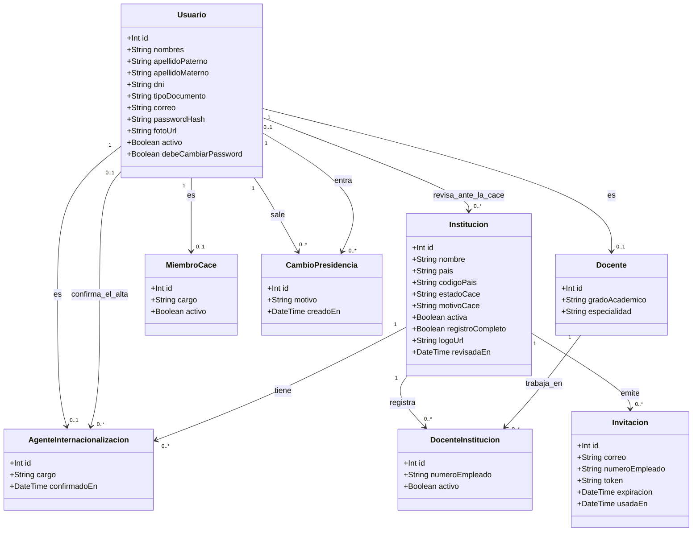
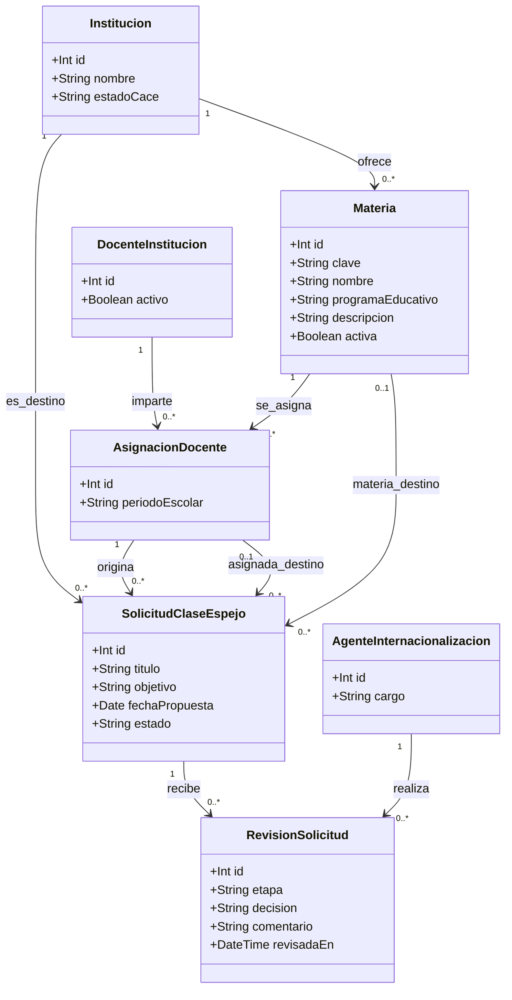
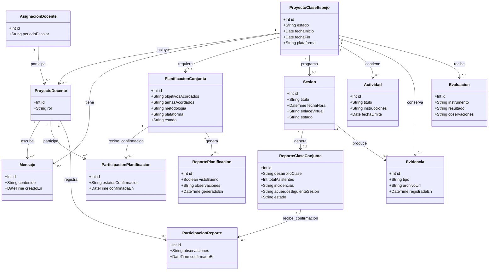
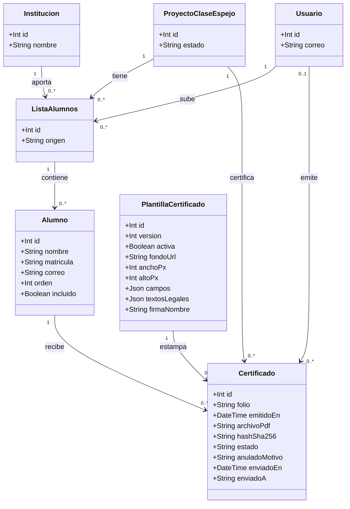
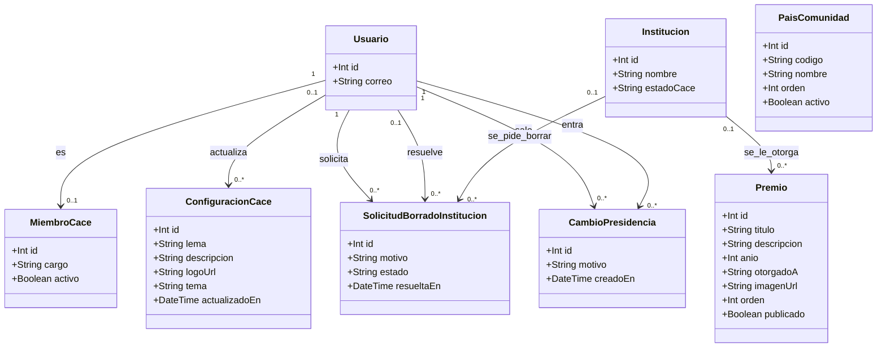

# 🧩 Diagrama de clases del dominio

Las clases de este documento son los **modelos de Prisma** leídos de
`backend/prisma/schema.prisma` (35 modelos), con sus atributos principales, sus
relaciones y sus **cardinalidades**. Se agrupan por área para que se lean: un
diagrama con las 35 clases y sus relaciones es un dibujo ilegible.

> **Nota importante — las clases del código no son las tablas.** Aquí se dibuja
> lo que el sistema **guarda y relaciona**. Las operaciones no están en estas
> clases: los modelos de Prisma son **solo datos, sin métodos**. Lo que hace el
> sistema vive en los **servicios** 3`backend/src/*/**.service.ts`), la puerta de
> entrada son los **controladores** 3`*.controller.ts`, 23 clases en 22 archivos)
> y las reglas transversales en `backend/src/common/` 3`estados.ts`,
> `capacidades.ts`, `plazos.ts`…). Ninguno de esos aparece en este diagrama a
> propósito: no son entidades del dominio.
>
> La versión **de tablas y columnas**, con los nombres físicos y el detalle de
> cada campo, está en [`entidad_relacion.md`]3entidad_relacion.md). Este
> documento es su lectura como **clases**, agrupada por área.

**Convenciones**

* `+` = atributo. El tipo va delante 3`Int`, `String`, `Boolean`, `DateTime`,
  `Date`, `Json`).
* Las cardinalidades se leen como en UML: `"1" --> "0..*"` es *uno a muchos* y
  `"1" --> "0..1"` es una relación **opcional** 3uno a cero o uno).
* Los campos que admiten nulos en la base no se marcan con símbolos: se ven en
  la cardinalidad de su relación y en las notas de cada área.

---

## 1. Identidad, acceso e institución

Quién es quién y a qué institución pertenece. Aquí está la decisión de diseño
que sostiene todo el modelo de permisos: **el rol no es una columna de
`Usuario`**, se deduce de las filas de agente, docente o miembro de la CACE.



**Notas del área**

* `Usuario` es la cuenta; **el rol se resuelve por relación**
  3`backend/src/common/capacidades.ts`): hay fila en
  `AgenteInternacionalizacion`, en `Docente` o en `MiembroCace`. Una fila de
  `MiembroCace` con `activo = false` **no cuenta**.
* `MiembroCace.cargo` es `PRESIDENTE`, `SUPLENTE` o `SECRETARIA`. Presidencia y
  suplencia comparten rol y capacidades; el suplente es otra fila, y por eso la
  presidencia **se transmite** sin borrar ni desactivar a nadie, dejando el
  cambio en `CambioPresidencia`.
* `Institucion.estadoCace` 3`PENDIENTE`, `APROBADA`, `RECHAZADA`, `VETADA`) es
  **independiente** de `activa`, que es el apagado operativo. `motivoCace`,
  `revisadaEn` y `revisadaPorUsuarioId` dejan constancia de la decisión.
* `DocenteInstitucion` es la pertenencia real de un docente a una institución
  3con su número de empleado y su `activo`): un docente puede estar en más de
  una.
* `AgenteInternacionalizacion.confirmadoEn` es nulo mientras el alta de un
  agente nuevo no la confirma otro agente de la institución ya aprobada.
* `Invitacion.token` es único y `usadaEn` impide reutilizarlo.

---

## 2. Oferta académica y solicitud de clase espejo

El catálogo de materias, la asignación docente ↔ materia 3que es el vínculo que
usan las solicitudes) y la **doble revisión** de una propuesta.



**Notas del área**

* `AsignacionDocente` es la unidad que viaja en una solicitud: **docente +
  materia + periodo escolar, dentro de una institución**. Por eso el origen y el
  destino de una clase espejo son asignaciones, no docentes sueltos.
* La solicitud guarda institución y materia de **destino**; la asignación de
  destino es **opcional** 3al proponer todavía no se sabe qué docente la
  recibirá) y la materia de destino también.
* `RevisionSolicitud` es el rastro de la **doble revisión**: `etapa` es
  `REVISION_ORIGEN` o `REVISION_DESTINO`, `decision` es la aprobación o el
  rechazo y `comentario` guarda el motivo. Una solicitud acumula varias filas.
* Los estados de la solicitud 3`PENDIENTE`, `APROBADA_POR_ORIGEN`, `APROBADA`,
  `RECHAZADA`, `CADUCADA`) están en `backend/src/common/estados.ts` y se dibujan
  en [`estados.md`]3estados.md).

---

## 3. El proyecto: planificación, ejecución y cierre

Lo que ocurre cuando la solicitud se aprueba y nace el **proyecto de clase
espejo**: los docentes participantes, el chat, la planificación conjunta con su
reporte, las sesiones con su reporte de clase y sus firmas, las actividades, las
evidencias y la evaluación final.



**Notas del área**

* `ProyectoClaseEspejo.solicitudId` es **único**: un proyecto nace de una sola
  solicitud, y la solicitud aprobada no puede generar dos proyectos.
* `PlanificacionConjunta.proyectoId` es único 3una planificación por proyecto) y
  `ReportePlanificacion.planificacionId` también 3un reporte de planificación
  por planificación).
* `Sesion` y `ReporteClaseConjunta` están en **uno a cero o uno**: una sesión
  tiene como mucho un reporte de clase, y ese reporte es el que reúne las firmas
  3`ParticipacionReporte`) de los docentes participantes.
* `Evidencia` cuelga del proyecto y **opcionalmente** de una sesión: hay
  evidencias de la clase entera y evidencias de una sesión concreta.
* `Actividad` cuelga solo del proyecto 3no de la sesión), aunque tenga
  `fechaLimite`.
* `ProyectoDocente.rol` no es el rol del usuario en el sistema: es el **papel
  dentro de esta clase espejo** 3el lado desde el que participa).
* Los estados de este bloque están en [`estados.md`]3estados.md): proyecto
  3`EN_PLANIFICACION`, `EN_CURSO`, `FINALIZADO`, `CANCELADO`), planificación
  3`BORRADOR`, `EN_REVISION`, `APROBADA`), sesión 3`PROGRAMADA`, `EN_CURSO`,
  `FINALIZADA`, `CANCELADA`), reporte 3`BORRADOR`, `EN_REVISION`, `CONFIRMADO`)
  y confirmaciones 3`PENDIENTE`, `CONFIRMADA`).

---

## 4. Lista de alumnos y certificados

El final del ciclo: cada institución sube su lista, de ahí salen los alumnos y
sobre la plantilla versionada de la CACE se emite el certificado.



**Notas del área**

* La lista es **única por 3proyecto, institución)**: cada institución sube la
  suya y no hay dos listas de la misma institución en la misma clase.
  `ListaAlumnos.origen` es `EXCEL`, `CSV` o `PEGADO`.
* `Alumno.incluido` permite dejar a alguien fuera de los certificados sin
  borrarlo de la lista; `matricula` distingue homónimos y `correo` es a dónde va
  el certificado. Solo el nombre es obligatorio.
* `PlantillaCertificado` está **versionada**: al cambiarla se crea una versión
  nueva y se activa. Los certificados ya emitidos apuntan a la versión con la
  que salieron, así que **no cambian nunca**. `campos` y `textosLegales` son
  JSON.
* `Certificado` guarda el PDF tal como se emitió 3`archivoPdf`) con su
  `hashSha256` y su `folio` único 3`CACE-AAAA-0000`). `estado` es `EMITIDO` o
  `ANULADO`, y `anuladoMotivo` explica por qué.
* **El código de verificación no tiene columna**: se **deriva** del folio con un
  HMAC del secreto del servidor. Por eso los certificados ya emitidos tienen su
  código sin migrar nada.
* `enviadoEn` y `enviadoA` registran el envío por correo al alumno.

---

## 5. Identidad de la CACE y gobierno de la comunidad

Las tablas que dan identidad a la comunidad y las que sostienen las decisiones
de gobierno: premios, países, personalización, solicitudes de borrado y el
historial de la presidencia.



**Notas del área**

* `ConfiguracionCace` es de **una sola fila** por diseño: lema, descripción,
  logo y tema visual. El tema es una de las diez claves de la lista cerrada de
  `backend/src/common/temas-cace.ts` 3no hay color libre, para no romper el
  contraste).
* `PaisComunidad.codigo` es el ISO de dos letras 3de ahí sale la bandera) y es
  único; `activo` decide si se publica.
* `Premio.publicado` decide si se ve en la sección pública de la comunidad.
* `SolicitudBorradoInstitucion.institucionId` **admite nulos a propósito**: la
  solicitud sobrevive al borrado de su institución, para que quede registrado
  quién lo pidió y quién lo autorizó.
* `PaisComunidad` es la única clase **sin ninguna relación**: es una lista suelta
  de países 3código ISO único, nombre, orden y activo) que solo se lee para
  pintar las banderas.
* `CambioPresidencia` es el historial de las transmisiones: quién salió, quién
  entró, el motivo y la fecha. Es la única tabla de gobierno que no cuelga de
  una institución.
* `MiembroCace` se repite aquí porque es la pieza que reparte los cargos de la
  CACE, pero su definición y sus cardinalidades están en el área 1.

---

## 6. Cómo se relacionan las áreas

El recorrido completo, de una punta a otra, es este:

```text
Institucion ──3aprobación de la CACE)──► opera
     │
     ▼
Usuario ── Docente ── DocenteInstitucion ── AsignacionDocente ── Materia
     │                                              │
     │                                              ▼
     │                                     SolicitudClaseEspejo ── RevisionSolicitud
     │                                              │  3doble revisión)
     │                                              ▼
     │                                     ProyectoClaseEspejo
     │                                              │
     │            ┌─────────────────────────────────┼──────────────────────────┐
     │            ▼                                 ▼                          ▼
     │     PlanificacionConjunta              Sesion ── ReporteClaseConjunta   Evaluacion
     │     3participaciones y reporte)        3actividades y evidencias)
     │                                              │
     │                                              ▼  3cierre: FINALIZADO)
     │                                       ListaAlumnos ── Alumno
     │                                                          │
     ▼                                                          ▼
MiembroCace 3PRESIDENTE / SUPLENTE / SECRETARIA) ──► PlantillaCertificado ──► Certificado
     │                                                                              │
     └── CambioPresidencia 3transmisiones)                    /verificar/:folio?c=código
```

> **Una sola fuente para los nombres.** Las clases, los atributos y las
> cardinalidades de este documento están leídos de
> `backend/prisma/schema.prisma`. Si el esquema cambia, este documento y
> [`entidad_relacion.md`]3entidad_relacion.md) hay que rehacerlos: son su
> lectura gráfica, no una definición aparte.