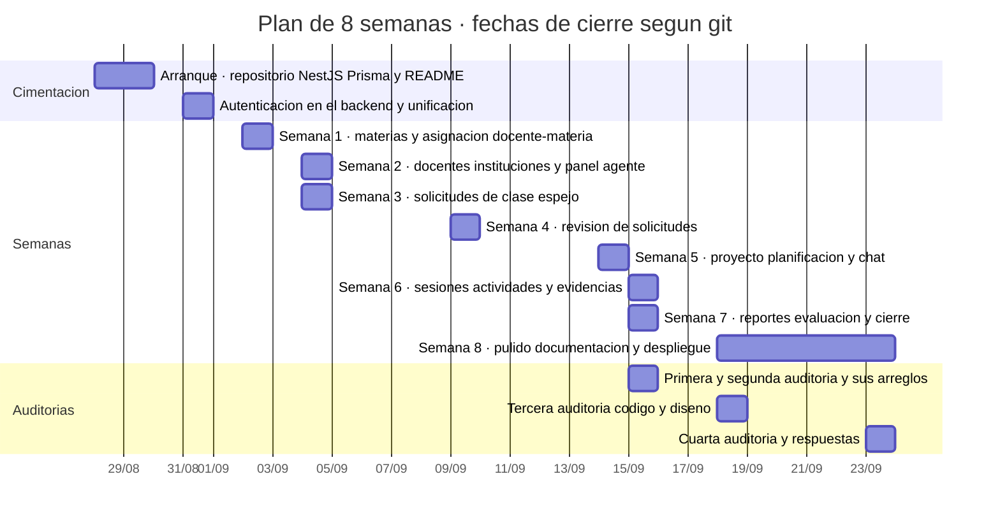
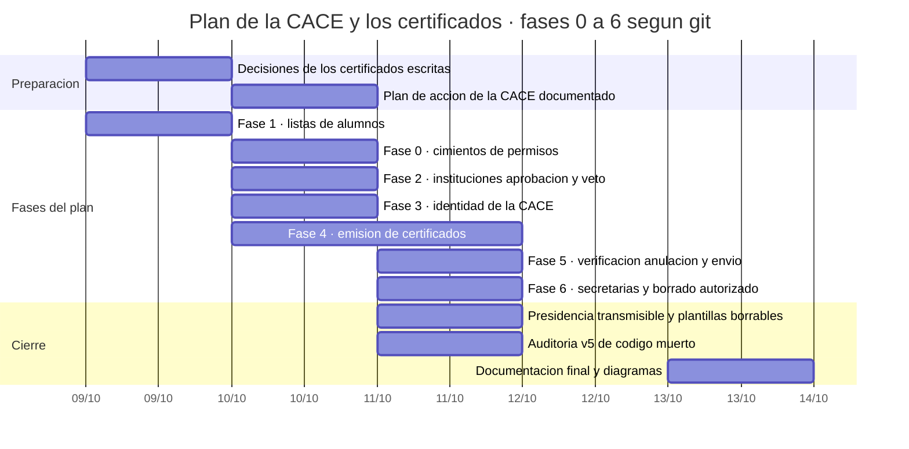

# 📅 Cronograma del proyecto (Gantt)

El cronograma está montado con **fechas reales del historial de git**
(`git log --date=short --pretty=format:"%ad %s"`), no con fechas inventadas. Hay
dos planes en el proyecto y se dibujan por separado:

1. el **plan de 8 semanas** (28-ago → 23-sep-2026), que es el que describe el
   README, y
2. el **plan de acción de la CACE y los certificados** (`docs/producto/plan-de-accion.md`,
   acordado el 10-oct-2026) con sus **fases 0 a 6**.

> **Las barras marcan el día del commit**, no una duración medida. El historial
> da **cuándo se cerró cada entregable**; no da cuándo se empezó. Por eso casi
> todas las barras duran un día: es lo único que el repositorio puede demostrar.

---

## 1. Plan de 8 semanas (28-ago → 23-sep-2026)



**Evidencia de cada barra** (commit y fecha, tal como los da git):

| Barra | Fecha | Commit (mensaje) |
| --- | --- | --- |
| Arranque | 28–29 ago | `Initial project setup` · `fix: configurar NestJS Prisma y variables de entorno` · `creacion del radme` (2 commits) |
| Autenticación en el backend | 31 ago | `feat: backend auth, timestamps, migraciones y unificar frontend en el repo` |
| Semana 1 | 02-sep | `feat: semana 1 - materias y asignacion docente-materia` |
| Semana 2 | 04-sep | `feat: correcciones de revision y semana 2 (docentes, instituciones y panel del agente)` |
| Semana 3 | 04-sep | `feat: semana 3 - solicitudes de clase espejo (lado docente)` |
| Semana 4 | 09-sep | `feat: semana 4 - revisión de solicitudes (lado agente)` |
| Semana 5 | 14-sep | `feat: semana 5 - proyectos, planificación conjunta y chat entre docentes` |
| Semana 6 | 15-sep | `feat: semana 6 - sesiones, actividades y evidencias` |
| Semana 7 | 15-sep | `feat: semana 7 - reportes de clase, evaluación final y cierre` |
| Semana 8 | 18-sep → 23-sep | `docs: readme actualizado, manual de usuario y guías de despliegue` · `feat(interfaz): esqueleto compartido…` · `fix(build): compilar el frontend directo en backend/public` · `docs: informe de actividades con evidencia` |
| Auditorías 1 y 2 | 15-sep | `fix: auditoría de QA - hallazgos de las dos revisiones` |
| Auditoría 3 | 18-sep | `fix(backend): reglas de negocio y validaciones de la tercera auditoría` · `fix(frontend): accesibilidad, contraste y estados de carga…` |
| Auditoría 4 | 23-sep | `fix(fechas): las columnas DATE dejan de desplazarse un día (QA-01) y la aprobación es atómica (QA-10)` |

---

## 2. Fases 0 a 6 del plan de la CACE y los certificados (09-oct → 13-oct-2026)



**Evidencia de cada barra:**

| Barra | Fecha (git) | Commit (mensaje) |
| --- | --- | --- |
| Fase 1 · listas de alumnos | 09-oct | `Listas de alumnos: tablas nuevas y arreglo de una migracion perdida` · `Listas de alumnos: Excel, CSV o pegada (Fase 1 de los certificados)` |
| Fase 0 · cimientos de permisos | 10-oct | `Fase 0 (cimientos de permisos): capacidades, guardia y campo de contrasena` · `Fase 0: tabla MIEMBRO_CACE y resolucion del rol de la CACE` · `Fase 0 completa: alta automatica del presidente y cambio de contrasena` |
| Fase 2 · instituciones | 10-oct | `Fase 2 (primera parte): estados de institucion, aprobacion, rechazo y veto` · `Fase 2 (segunda parte): registro sin duplicados, alta confirmada y borrado` |
| Fase 3 · identidad de la CACE | 10-oct | `Fase 3: identidad de la CACE (personalizacion, comunidad y premios)` |
| Fase 4 · emisión de certificados | 10–11 oct | `Editor visual de la plantilla del certificado (arrastrar, redimensionar y escribir encima)` (10-oct) · `Fase 4: emision de certificados con plantilla del presidente` (10-oct) · `Certificados simplificados: el diseno se hace fuera y la app estampa tres datos` · `Rediseno de la pantalla del certificado…` (11-oct) |
| Fase 5 · verificación, anulación y envío | 11-oct | `Fase 5: verificacion publica, anulacion y envio por correo de los certificados` |
| Fase 6 · secretarías y borrado autorizado | 11-oct | `Fase 6 (ultima): secretarias de la CACE y borrado con autorizacion` |
| Presidencia transmisible | 11-oct | `La presidencia se transmite (no se borra) y las plantillas se pueden borrar` |
| Auditoría v5 | 11-oct | `Corrige la auditoria v5 de codigo muerto, duplicacion y residuos` |
| Documentación final | 13-oct | `Pone al dia la documentacion: README, los seis diagramas y el respaldo (solo .md)` · `Comitea los cambios del otro agente, verificados (tema ANIVERSARIO, panel CACE y presupuesto del CSS)` |
| Plan de acción documentado | 10-oct | `Documenta el plan de accion del presidente de la CACE y lo une al de certificados` |

> **El día del documento.** El propio `plan-de-accion.md` dice que se **acordó el
> 10 de octubre de 2026**, la misma fecha que sus primeros commits.

---

## 3. Qué dice el historial y qué no

### 3.1 Donde el historial **no** da una fecha clara

* **La fase 1 es anterior a la fase 0.** En el plan, la 1 va antes que la 0, pero
  sus commits son del **9-oct** y los de la fase 0 del **10-oct**. Explicación:
  las listas de alumnos ya estaban hechas cuando se escribió el plan, que las
  marca ✅ y arranca por los cimientos de permisos.
* **El 10-oct se solapan cuatro fases** (0, 2, 3 y 4) en el mismo día. El
  historial no permite decir a qué hora se cerró cada una, así que las barras se
  dibujan una al lado de otra y **no** como una duración real.
* **No hay fecha de inicio de nada, solo de cierre.** Git dice cuándo se
  registró el trabajo terminado; el tiempo dedicado a cada fase no se puede
  deducir de ahí (y menos con commits que agrupan varias cosas).
* **No hay commits posteriores al 13-oct-2026.** El último es
  `8ad7f50` (13-oct, «Pone al dia la documentacion…») y el árbol está limpio, así
  que el cronograma termina ahí.
* **El plan no marca lo mismo que el README.** En `plan-de-accion.md` solo
  llevan ✅ las fases **1, 5 y 6**; el README dice que las **seis** (0 a 6) están
  implementadas. La diferencia es de forma: el plan se escribió a la vez que se
  hacían las fases y no se volvió a marcar la tabla. Las fases 0, 2, 3 y 4 sí
  tienen commits con su nombre —la 0 incluso dice «Fase 0 completa»—, pero **el
  documento del plan no se actualizó** para ponerles el ✅.
* **La fase 6 incluye la transmisión de la presidencia** en el README, pero en el
  historial la transmisión tiene **commit propio** el mismo día
  (`La presidencia se transmite…`), así que va como barra aparte.

### 3.2 Ambientes y documentos que fechan cosas sin commit

| Documento | Fecha que declara | ¿Coincide con git? |
| --- | --- | --- |
| `docs/producto/plan-de-accion.md` | Acordado el **10-oct-2026** | Sí: primer commit del plan, 10-oct. |
| `docs/informes/informe-de-actividades.md` | 23-sep-2026 | Sí: es su fecha de commit. |
| `docs/auditorias/reporte-qa-clasesespejo.md` | «hoy (enero 2026)» | **No**: su revisión corresponde al 15-sep-2026 (lo advierte el informe de actividades §12.3). |
| `docs/auditorias/auditoria-codigo-muerto-v5.md` | 2026-09-23, con commit auditado `51115a9` | **No**: ese commit es del **11-oct-2026** según git. |
| `docs/guias/respaldo-y-restauracion.md` | Respaldo vigente `clasesconjuntas_respaldo_20261013` | Sí: el nombre lleva la fecha del 13-oct. |

> **Regla para futuras mediciones:** las fechas de los **commits** son la fuente
> fiable; las que aparecen escritas **dentro** de los informes de auditoría no lo
> son, y hay que corregirlas antes de usarlas en la tesis.

### 3.3 Cómo volver a sacar el cronograma

```bash
git log --date=short --pretty=format:"%ad %s"          # fecha y mensaje de cada commit
git log --date=short --pretty=format:"%ad %s" --reverse # en orden cronológico
```
