```mermaid
%%{init: {
    "theme": "base",
    "themeVariables": {
        "background": "#F5F7FA",
        "primaryTextColor": "#1F2937",
        "lineColor": "#64748B",
        "fontFamily": "Arial"
    }
}}%%

flowchart TD

    %% ==========================================
    %% PUESTA EN MARCHA: INSTITUCIÓN ANTE LA CACE
    %% ==========================================

    A([Inicio]) --> A0{¿Existe ya la institución<br/>en el directorio?}
    A0 -->|Sí| A1[El agente se une a ella<br/>y completa sus datos]
    A0 -->|No| A2[El agente la crea<br/>con todos sus datos]
    A1 --> A3[Estado ante la CACE:<br/>Pendiente]
    A2 --> A3

    A3 --> A4{La presidencia de la CACE<br/>revisa la institución}
    A4 -->|Aprobar| A5[Estado: Aprobada]
    A4 -->|Rechazar o vetar| A6[Estado: Rechazada / Vetada<br/>con motivo]
    A6 -. "lo arregla y se reactiva" .-> A5
    A6 -. "rechazada y sin historia" .-> A7([Borrado definitivo])

    A5 --> B[El agente invita a sus docentes por correo]
    B --> B0{¿La institución ya estaba aprobada?}
    B0 -->|No| C[Docente activa su cuenta por el enlace recibido]
    B0 -->|Sí, es un agente nuevo| B1[Un agente de la institución<br/>confirma su alta]
    B1 --> C
    C --> D[El agente registra materias]
    D --> E[Asigna cada materia a un docente]

    %% ==========================================
    %% SOLICITUD
    %% ==========================================

    E --> F[Docente crea solicitud de clase espejo]
    F --> G[Selecciona materia, institución destino,<br/>objetivo y fecha propuesta]
    G --> H[Estado: Pendiente]

    %% ==========================================
    %% DOBLE REVISIÓN
    %% ==========================================

    H --> I{Agente de institución ORIGEN<br/>revisa la solicitud}
    H -. "nadie responde a tiempo" .-> C1[Estado: Caducada]
    C1 -. "reenviar con fecha nueva" .-> H

    I -->|Rechazar| K[Indica motivo]
    K --> L[Estado: Rechazada]
    L --> M{¿El docente corrige y reenvía?}
    M -->|Sí| H
    M -->|No| Z([Fin])

    I -->|Aprobar| N[Estado: Aprobada por origen]

    N -. "nadie confirma a tiempo" .-> C1

    N --> O{Agente de institución DESTINO<br/>revisa la solicitud}
    O -->|Rechazar| K
    O -->|Aprobar| P[Estado: Aprobada]

    %% ==========================================
    %% PROYECTO Y PLANIFICACIÓN
    %% ==========================================

    P --> Q[Se crea el proyecto de clase espejo]
    Q --> R[Docentes de ambas instituciones<br/>hacen la planificación conjunta]
    R --> S[Definen objetivos, temas, metodología<br/>y plataforma]
    S --> T[Cada docente confirma su participación]
    T --> U[Estado: En planificación]

    %% ==========================================
    %% EJECUCIÓN
    %% ==========================================

    U --> V[Estado: En curso]
    V --> W[Realizar la clase espejo conjunta]
    W --> X[Registrar sesiones, actividades y evidencias]

    X --> AA[Firmar el reporte de clase de cada sesión]

    AA --> AB{¿Hay más sesiones?}
    AB -->|Sí| W
    AB -->|No| AC[Registrar la evaluación final]

    %% ==========================================
    %% CIERRE
    %% ==========================================

    AC --> AD[Validar: evaluación final y<br/>reportes de sesión confirmados]
    AD --> AE[Estado: Finalizado]

    %% ==========================================
    %% LISTA DE ALUMNOS Y CERTIFICADOS
    %% ==========================================

    AE --> CA[El docente sube la lista de<br/>SUS alumnos: Excel, CSV o pegado]
    CA --> CB[Revisión en vista previa editable:<br/>repetidos, nombres imposibles,<br/>correos mal escritos]
    CB --> CC{El docente emite<br/>los certificados}
    CC -->|Solo con la clase cerrada| CD[La aplicación estampa<br/>nombre, folio y QR<br/>sobre la plantilla de la CACE]
    CD --> CE[PDF guardado con su hash SHA-256<br/>y folio CACE-AAAA-0000]
    CE --> CF[Descarga individual, en ZIP,<br/>o envío por correo al alumno]
    CE --> CG[El QR lleva<br/>/verificar/folio?c=código]
    CG --> CH[Verificación pública, sin sesión:<br/>Válido, Anulado, No encontrado o Inválido]
    CE -. "se anula con motivo<br/>(docente o presidencia)" .-> CI[Estado del certificado: Anulado]
    CI -. "el QR sigue explicando<br/>que ya no vale" .-> CH

    AE --> Z

    %% ==========================================
    %% IDENTIDAD DE LA CACE (en paralelo)
    %% ==========================================

    A5 -.-> ID[La presidencia personaliza la CACE:<br/>lema, descripción, logo, tema,<br/>países de la comunidad y premios]
    ID -. "es la plantilla que se estampa" .-> CD

    %% ==========================================
    %% ESTILOS
    %% ==========================================

    classDef inicioFin fill:#E2E8F0,stroke:#475569,color:#1E293B,stroke-width:3px
    classDef agente fill:#DBEAFE,stroke:#2563EB,color:#1E3A8A,stroke-width:3px
    classDef docente fill:#FEF3C7,stroke:#D97706,color:#78350F,stroke-width:3px
    classDef cace fill:#E0E7FF,stroke:#4F46E5,color:#312E81,stroke-width:3px
    classDef solicitud fill:#EDE9FE,stroke:#7C3AED,color:#4C1D95,stroke-width:3px
    classDef rechazo fill:#FEE2E2,stroke:#DC2626,color:#7F1D1D,stroke-width:3px
    classDef caducada fill:#FFF7ED,stroke:#F59E0B,color:#7C2D12,stroke-width:3px
    classDef aprobado fill:#DCFCE7,stroke:#16A34A,color:#14532D,stroke-width:3px
    classDef planeacion fill:#FFEDD5,stroke:#EA580C,color:#7C2D12,stroke-width:3px
    classDef ejecucion fill:#CCFBF1,stroke:#0D9488,color:#134E4A,stroke-width:3px
    classDef certificado fill:#FDF4FF,stroke:#A21CAF,color:#701A75,stroke-width:3px
    classDef sistema fill:#F1F5F9,stroke:#64748B,color:#334155,stroke-width:2px

    class A,A7,Z inicioFin
    class B,B0,B1,C,D,E,F,I,O agente
    class G,H,M,R,S,T,W,X,AA,AC,CA,CB,CC docente
    class A0,A3,A4,A5,A6 cace
    class I,N,L solicitud
    class K rechazo
    class C1 caducada
    class P,Q,AE aprobado
    class R,S,U planeacion
    class V,W,X,AB ejecucion
    class CD,CE,CF,CG,CH,CI certificado
    class AD,ID sistema
```

> **Nota sobre la caducidad.** Las solicitudes que siguen en *Pendiente* (nadie
> respondió) o en *Aprobada por origen* (nadie confirmó) al cumplirse el plazo
> pasan a **Caducada** automáticamente. No las rechaza una institución: las
> cancela el sistema, y el docente puede reenviarlas con una fecha nueva.

> **Nota sobre la institución.** El estado ante la CACE es **independiente** del
> apagado operativo (`activa`). Una institución *Pendiente*, *Rechazada* o
> *Vetada* no puede operar: su agente solo ve y completa los datos de su
> institución. El **borrado definitivo** solo cabe sobre una *Rechazada* **sin
> historia** (sin clases ni revisiones), y lo autoriza la presidencia: la
> secretaría puede **pedirlo** (`/cace/solicitudes-borrado`) y la presidencia
> aprobarlo, momento en el que se ejecuta.

> **Nota sobre los certificados.** El **diseño se hace fuera** de la aplicación
> (Canva, Word…) y se sube como imagen terminada: la plataforma solo estampa
> **nombre** (con autoajuste de tamaño), **folio** y **QR**. El PDF emitido es
> **inmutable** (se guarda con su `hash_sha256`), el folio es
> `CACE-<año>-<consecutivo>` y el QR lleva dentro el **código de verificación**,
> que se deriva del folio con un HMAC del secreto del servidor (no se guarda en
> ninguna columna). Solo se emite con la clase **Finalizada**.
