```mermaid
%%{init: {
    "theme": "base",
    "themeVariables": {
        "background": "#F5F7FA",
        "primaryTextColor": "#1F2937",
        "lineColor": "#64748B",
        "fontFamily": "Arial",

        "er.entityBox": "#FFFFFF",
        "er.entityBorder": "#475569",
        "er.attributeBoxOdd": "#F8FAFC",
        "er.attributeBoxEven": "#EEF2F7",
        "er.attributeBorder": "#CBD5E1",
        "er.relationshipLabelBox": "#FFFFFF",
        "er.relationshipLabelColor": "#334155"
    }
}}%%

erDiagram
    INSTITUCION {
        int id PK
        string nombre
        string pais
        string codigo_pais
        string estado
        string ciudad
        string telefono
        string correo_institucional
        boolean activa
        boolean registro_completo
        string estado_cace "PENDIENTE / APROBADA / RECHAZADA / VETADA"
        string motivo_cace "motivo del rechazo o del veto"
        string logo_url "opcional"
        int revisada_por_usuario_id FK "opcional"
        datetime revisada_en "opcional"
    }

    USUARIO {
        int id PK
        string nombres
        string apellido_paterno
        string apellido_materno
        string dni "unique"
        string tipo_documento
        string correo "unique"
        string password_hash "opcional"
        string foto_url "opcional"
        boolean activo
        boolean debe_cambiar_password
    }

    INVITACION {
        int id PK
        string correo
        string numero_empleado
        int institucion_id FK
        string token "unique"
        datetime expiracion
        datetime usada_en "opcional"
    }

    AGENTE_INTERNACIONALIZACION {
        int id PK
        int usuario_id FK "unique"
        int institucion_id FK
        string cargo
        datetime confirmado_en "opcional: alta por confirmar"
        int confirmado_por_usuario_id FK "opcional"
    }

    DOCENTE {
        int id PK
        int usuario_id FK "unique"
        string grado_academico
        string especialidad
    }

    DOCENTE_INSTITUCION {
        int id PK
        int docente_id FK
        int institucion_id FK
        string numero_empleado
        boolean activo
    }

    MATERIA {
        int id PK
        int institucion_id FK
        string clave
        string nombre
        string programa_educativo
        string descripcion
        boolean activa
    }

    ASIGNACION_DOCENTE {
        int id PK
        int docente_institucion_id FK
        int materia_id FK
        string periodo_escolar
    }

    SOLICITUD_CLASE_ESPEJO {
        int id PK
        int asignacion_origen_id FK
        int asignacion_destino_id FK "opcional"
        int institucion_destino_id FK
        int materia_destino_id FK "opcional"
        string titulo
        string objetivo
        date fecha_propuesta
        string estado
    }

    REVISION_SOLICITUD {
        int id PK
        int solicitud_id FK
        int agente_id FK
        string etapa
        string decision
        string comentario
        datetime revisada_en
    }

    PROYECTO_CLASE_ESPEJO {
        int id PK
        int solicitud_id FK "unique"
        string estado
        date fecha_inicio
        date fecha_fin
        string plataforma
    }

    PROYECTO_DOCENTE {
        int id PK
        int proyecto_id FK
        int asignacion_docente_id FK
        string rol
    }

    MENSAJE {
        int id PK
        int proyecto_id FK
        int proyecto_docente_id FK
        string contenido
        datetime creado_en
    }

    PLANIFICACION_CONJUNTA {
        int id PK
        int proyecto_id FK "unique"
        string objetivos_acordados
        string temas_acordados
        string metodologia
        string plataforma
        string estado
    }

    PARTICIPACION_PLANIFICACION {
        int id PK
        int planificacion_id FK
        int proyecto_docente_id FK
        string estatus_confirmacion
        datetime confirmada_en "opcional"
    }

    REPORTE_PLANIFICACION {
        int id PK
        int planificacion_id FK "unique"
        boolean visto_bueno
        string observaciones
        datetime generado_en
    }

    SESION {
        int id PK
        int proyecto_id FK
        string titulo
        datetime fecha_hora
        string enlace_virtual
        string estado
    }

    ACTIVIDAD {
        int id PK
        int proyecto_id FK
        string titulo
        string instrucciones
        date fecha_limite
    }

    REPORTE_CLASE_CONJUNTA {
        int id PK
        int sesion_id FK "unique"
        string desarrollo_clase
        int total_asistentes
        string incidencias
        string acuerdos_siguiente_sesion
        string estado
    }

    PARTICIPACION_REPORTE {
        int id PK
        int reporte_clase_id FK
        int proyecto_docente_id FK
        string observaciones
        datetime confirmado_en "opcional"
    }

    EVIDENCIA {
        int id PK
        int proyecto_id FK
        int sesion_id FK "opcional"
        string tipo
        string archivo_url
        datetime registrada_en
    }

    EVALUACION {
        int id PK
        int proyecto_id FK
        string instrumento
        string resultado
        string observaciones
    }

    LISTA_ALUMNOS {
        int id PK
        int proyecto_id FK
        int institucion_id FK
        int subida_por_usuario_id FK
        string origen "EXCEL / CSV / PEGADO"
    }

    ALUMNO {
        int id PK
        int lista_id FK
        string nombre
        string matricula
        string correo "opcional: para enviarle el certificado"
        int orden
        boolean incluido
    }

    MIEMBRO_CACE {
        int id PK
        int usuario_id FK "unique"
        string cargo "PRESIDENTE / SUPLENTE / SECRETARIA"
        boolean activo
    }

    CONFIGURACION_CACE {
        int id PK
        string lema
        string descripcion
        string logo_url "opcional"
        string tema
        int actualizado_por_usuario_id FK "opcional"
        datetime actualizado_en
    }

    PAIS_COMUNIDAD {
        int id PK
        string codigo "unique: ISO de dos letras"
        string nombre
        int orden
        boolean activo
    }

    PREMIO {
        int id PK
        string titulo
        string descripcion
        int anio
        string otorgado_a
        int institucion_id FK "opcional"
        string imagen_url "opcional"
        int orden
        boolean publicado
    }

    PLANTILLA_CERTIFICADO {
        int id PK
        int version
        boolean activa
        string fondo_url "opcional"
        int ancho_px
        int alto_px
        json campos "posicion y estilo de nombre, folio y QR"
        json textos_legales
        string firma_nombre
        int creada_por_usuario_id FK "opcional"
    }

    CERTIFICADO {
        int id PK
        string folio "unique: CACE-AAAA-0000"
        int alumno_id FK
        int proyecto_id FK
        int plantilla_id FK
        int emitido_por_usuario_id FK "opcional"
        datetime emitido_en
        string archivo_pdf
        string hash_sha256
        string estado "EMITIDO / ANULADO"
        string anulado_motivo
        datetime enviado_en "opcional"
        string enviado_a
    }

    SOLICITUD_BORRADO_INSTITUCION {
        int id PK
        int institucion_id FK "opcional: sobrevive al borrado"
        int solicitada_por_usuario_id FK
        string motivo
        string estado "PENDIENTE / APROBADA / RECHAZADA"
        int resuelta_por_usuario_id FK "opcional"
        datetime resuelta_en "opcional"
    }

    CAMBIO_PRESIDENCIA {
        int id PK
        int saliente_usuario_id FK
        int entrante_usuario_id FK
        string motivo
        datetime creado_en
    }

    %% =========================
    %% RELACIONES
    %% =========================

    USUARIO ||--o| AGENTE_INTERNACIONALIZACION : es
    USUARIO ||--o| DOCENTE : es
    USUARIO ||--o| MIEMBRO_CACE : es
    USUARIO ||--o{ LISTA_ALUMNOS : sube
    USUARIO ||--o{ INSTITUCION : revisa_ante_la_cace
    USUARIO ||--o{ AGENTE_INTERNACIONALIZACION : confirma_el_alta
    USUARIO ||--o{ CONFIGURACION_CACE : actualiza
    USUARIO ||--o{ PLANTILLA_CERTIFICADO : crea
    USUARIO ||--o{ CERTIFICADO : emite
    USUARIO ||--o{ SOLICITUD_BORRADO_INSTITUCION : solicita
    USUARIO ||--o{ SOLICITUD_BORRADO_INSTITUCION : resuelve
    USUARIO ||--o{ CAMBIO_PRESIDENCIA : sale
    USUARIO ||--o{ CAMBIO_PRESIDENCIA : entra

    INSTITUCION ||--o{ AGENTE_INTERNACIONALIZACION : tiene
    INSTITUCION ||--o{ INVITACION : emite
    INSTITUCION ||--o{ DOCENTE_INSTITUCION : registra
    INSTITUCION ||--o{ MATERIA : ofrece
    INSTITUCION ||--o{ LISTA_ALUMNOS : aporta
    INSTITUCION |o--o{ PREMIO : se_le_otorga
    INSTITUCION |o--o{ SOLICITUD_BORRADO_INSTITUCION : se_pide_borrar

    DOCENTE ||--o{ DOCENTE_INSTITUCION : trabaja_en
    DOCENTE_INSTITUCION ||--o{ ASIGNACION_DOCENTE : imparte
    MATERIA ||--o{ ASIGNACION_DOCENTE : se_asigna

    ASIGNACION_DOCENTE ||--o{ SOLICITUD_CLASE_ESPEJO : origina
    ASIGNACION_DOCENTE o|--o{ SOLICITUD_CLASE_ESPEJO : asignada_destino
    INSTITUCION ||--o{ SOLICITUD_CLASE_ESPEJO : es_destino
    MATERIA o|--o{ SOLICITUD_CLASE_ESPEJO : materia_destino

    SOLICITUD_CLASE_ESPEJO ||--o{ REVISION_SOLICITUD : recibe
    AGENTE_INTERNACIONALIZACION ||--o{ REVISION_SOLICITUD : realiza

    SOLICITUD_CLASE_ESPEJO ||--o| PROYECTO_CLASE_ESPEJO : genera
    PROYECTO_CLASE_ESPEJO ||--o{ PROYECTO_DOCENTE : incluye
    ASIGNACION_DOCENTE ||--o{ PROYECTO_DOCENTE : participa

    PROYECTO_CLASE_ESPEJO ||--o{ MENSAJE : tiene
    PROYECTO_DOCENTE ||--o{ MENSAJE : escribe

    PROYECTO_CLASE_ESPEJO ||--o| PLANIFICACION_CONJUNTA : requiere
    PLANIFICACION_CONJUNTA ||--o{ PARTICIPACION_PLANIFICACION : recibe_confirmacion
    PROYECTO_DOCENTE ||--o{ PARTICIPACION_PLANIFICACION : participa
    PLANIFICACION_CONJUNTA ||--o| REPORTE_PLANIFICACION : genera

    PROYECTO_CLASE_ESPEJO ||--o{ SESION : programa
    PROYECTO_CLASE_ESPEJO ||--o{ ACTIVIDAD : contiene

    SESION ||--o| REPORTE_CLASE_CONJUNTA : genera
    REPORTE_CLASE_CONJUNTA ||--o{ PARTICIPACION_REPORTE : recibe_confirmacion
    PROYECTO_DOCENTE ||--o{ PARTICIPACION_REPORTE : registra

    PROYECTO_CLASE_ESPEJO ||--o{ EVIDENCIA : conserva
    SESION o|--o{ EVIDENCIA : produce

    PROYECTO_CLASE_ESPEJO ||--o{ EVALUACION : recibe

    PROYECTO_CLASE_ESPEJO ||--o{ LISTA_ALUMNOS : tiene
    LISTA_ALUMNOS ||--o{ ALUMNO : contiene
    ALUMNO ||--o{ CERTIFICADO : recibe
    PROYECTO_CLASE_ESPEJO ||--o{ CERTIFICADO : certifica
    PLANTILLA_CERTIFICADO ||--o{ CERTIFICADO : estampa
```

---

## Notas del modelo

* **El rol no es una columna de `USUARIO`.** Alguien es agente si tiene fila en
  `AGENTE_INTERNACIONALIZACION`, docente si la tiene en `DOCENTE` y miembro de la
  CACE si la tiene en `MIEMBRO_CACE`. El rol se deduce de esos vínculos
  (`backend/src/common/capacidades.ts`), y una fila de miembro **inactiva** no
  cuenta.
* **`MIEMBRO_CACE.cargo`** distingue presidencia, suplencia y secretaría. La
  presidencia y la suplencia comparten rol y capacidades; el suplente es quien
  dejó el cargo, y no se borra ni se desactiva: la presidencia **se transmite**
  (cada cambio queda en `CAMBIO_PRESIDENCIA`).
* **`INSTITUCION.estado_cace`** (`PENDIENTE`, `APROBADA`, `RECHAZADA`, `VETADA`)
  es independiente de `activa`: el estado ante la CACE es el que explica por qué
  una institución no puede operar. `revisada_por_usuario_id`, `revisada_en` y
  `motivo_cace` dejan constancia de la decisión.
* **`SOLICITUD_BORRADO_INSTITUCION.institucion_id` admite nulos** a propósito: la
  solicitud sobrevive al borrado de su institución, para que quede registrado
  quién lo pidió y quién lo autorizó.
* **`LISTA_ALUMNOS`** es única por (`proyecto_id`, `institucion_id`): cada
  institución sube la suya y no hay dos listas de la misma institución en la
  misma clase. `ALUMNO.incluido` permite dejar a alguien fuera de los
  certificados sin borrarlo de la lista.
* **`PLANTILLA_CERTIFICADO` está versionada**: al cambiarla se crea una versión
  nueva y se activa, de modo que los certificados ya emitidos —que apuntan a su
  versión— no cambian nunca. `campos` y `textos_legales` son JSON.
* **`CERTIFICADO`** guarda el PDF tal como se emitió (`archivo_pdf`) con su
  `hash_sha256` y su `folio` único. `estado` es `EMITIDO` o `ANULADO`;
  `anulado_motivo` guarda el motivo. El código de verificación **no** tiene
  columna: se deriva del folio con un HMAC del secreto del servidor.
* **`CONFIGURACION_CACE` es de una sola fila** por diseño (textos, logo y tema).
  `PAIS_COMUNIDAD` y `PREMIO` son las otras dos tablas de la identidad de la
  CACE; `PREMIO.publicado` decide si se ve en la sección pública.
* El esquema completo, con los nombres exactos de las columnas, está en
  `backend/prisma/schema.prisma` (32 modelos/tablas).
