# 🔄 Diagrama de estados del sistema

Este documento reúne los **estados** de cada elemento del dominio y las
transiciones permitidas. Es la referencia visual de qué puede pasar de un estado
a otro y por qué.

> Fuente única de verdad en el código: `backend/src/common/estados.ts`.

---

## 1. Solicitud de clase espejo (doble revisión)

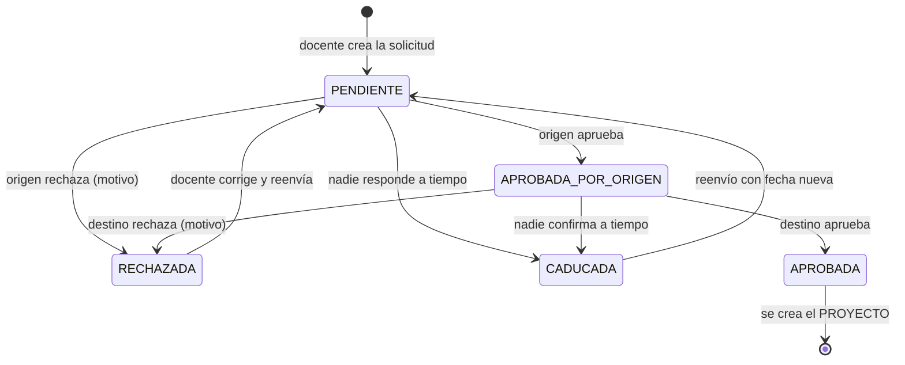

| Estado | Significado |
| --- | --- |
| **Pendiente** | Espera la primera revisión. |
| **Aprobada por origen** | La institución que propone ya aprobó; falta la de destino. |
| **Aprobada** | Ambas aprobaron; se creó el proyecto. |
| **Rechazada** | Alguna institución la rechazó (con motivo). |
| **Caducada** | Venció el plazo sin respuesta; la cancela el sistema. |

---

## 2. Proyecto (clase espejo)

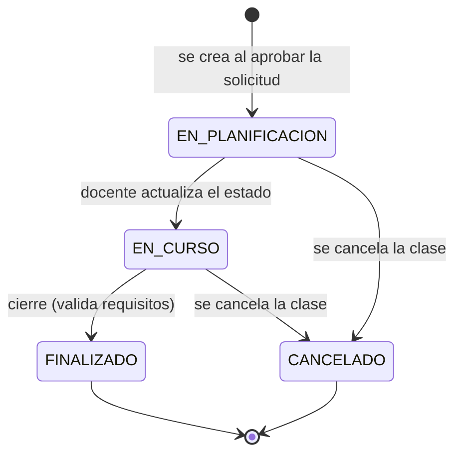

> `FINALIZADO` **no** se fija a mano: solo lo asigna la acción **Cerrar clase
> espejo**, que exige al menos una evaluación final y que cada sesión (no
> cancelada) tenga su reporte confirmado.

---

## 3. Sesión

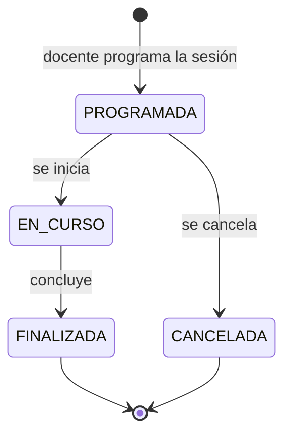

---

## 4. Reporte de clase (por sesión)

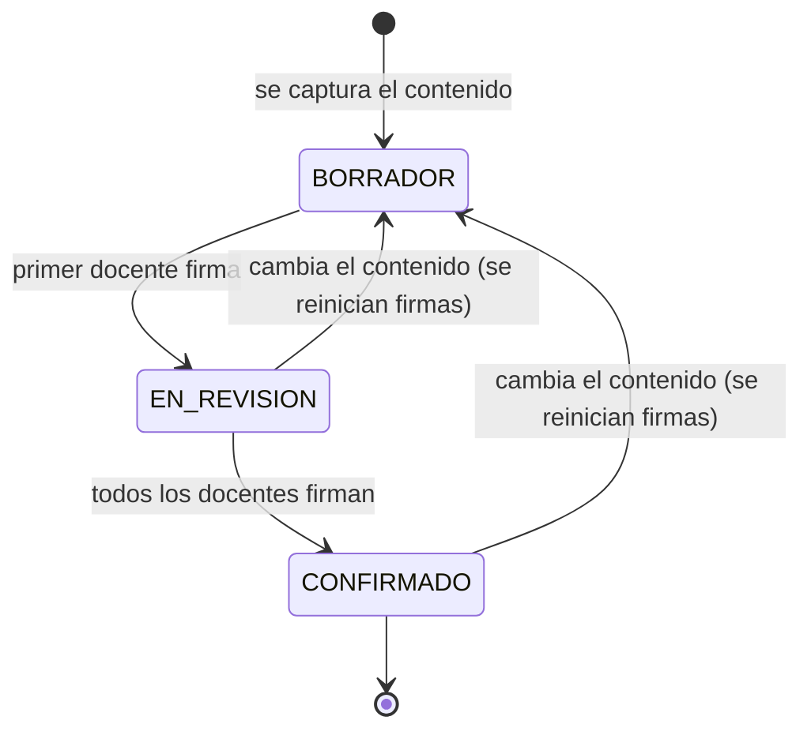

> Si el contenido del reporte cambia **después de firmado**, las firmas se
> reinician y el reporte vuelve a *Borrador*. Así una firma siempre corresponde
> al texto definitivo.

---

## 5. Planificación conjunta

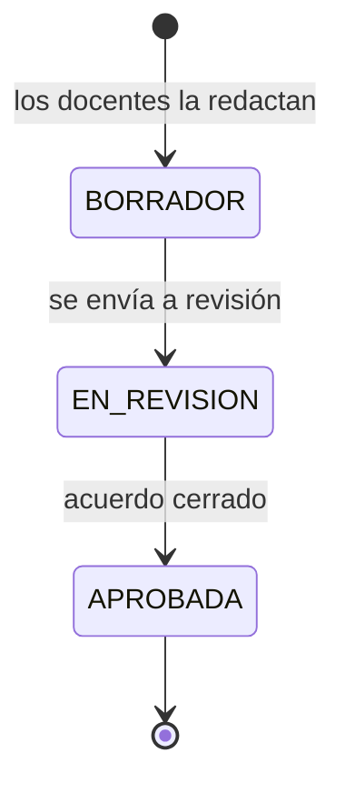

---

## 6. Participaciones (confirmación)

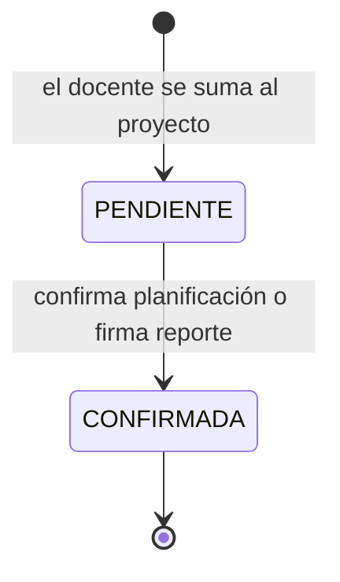

> Aplica por igual a la **confirmación de participación** en la planificación y
> a las **firmas** del reporte de clase.

---

## 7. Institución ante la CACE

El estado ante la CACE (`INSTITUCION.estado_cace`) es **independiente** de
`activa`, que sigue siendo el apagado operativo. Es este estado —y no `activa`—
el que explica **por qué** una institución no puede operar.

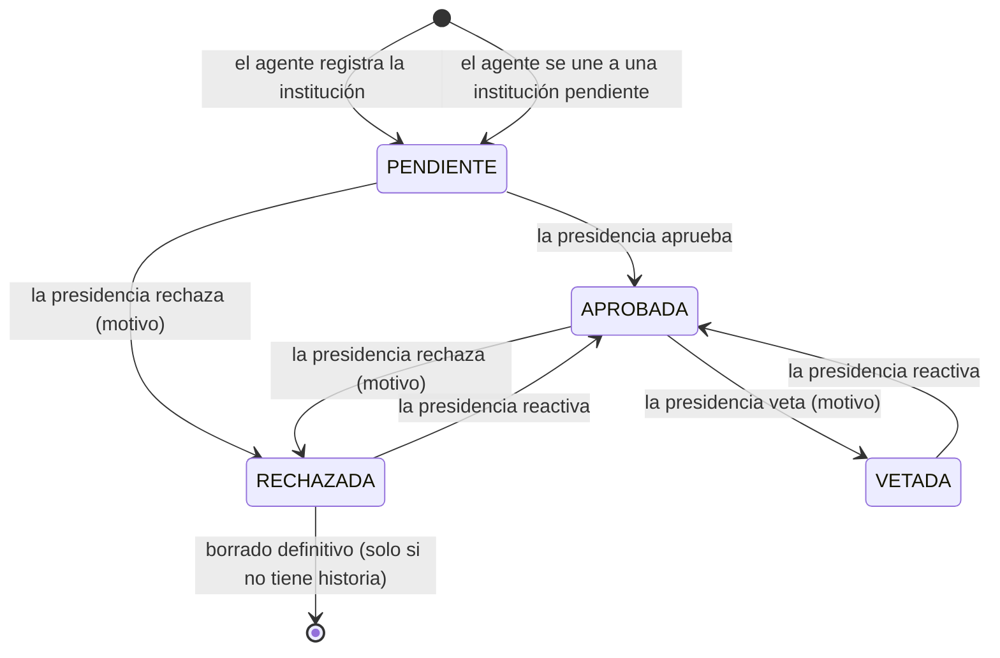

| Estado | Significado | ¿Puede operar? |
| --- | --- | --- |
| **Pendiente** | Acaba de registrarse; espera la decisión de la presidencia. | No: su agente solo completa los datos de la institución. |
| **Aprobada** | La CACE la aceptó. | Sí (si el agente, además, tiene su alta confirmada). |
| **Rechazada** | La presidencia la rechazó con motivo. | No, y **no admite agentes nuevos** (el registro se conserva para evitar el bucle de reinscripción). |
| **Vetada** | La presidencia la vetó con motivo: es la decisión más grave. | No, y no admite agentes nuevos. Las clases ya en curso siguen vivas. |

> Las instituciones que ya existían antes de que se añadiera este estado quedaron
> **aprobadas** en la migración, para no dejarlas fuera.
>
> El estado guarda además **quién** lo decidió (`revisada_por_usuario_id`) y
> **cuándo** (`revisada_en`), y el motivo del rechazo o del veto
> (`motivo_cace`). Ese motivo es obligatorio en los dos casos y viaja en el
> correo que se le manda al agente de la institución.

### 7.1 Alta del agente de una institución ya aprobada

Cuando alguien se **une** a una institución que ya está aprobada, su alta no la
decide la presidencia: la confirma un agente de esa misma institución.

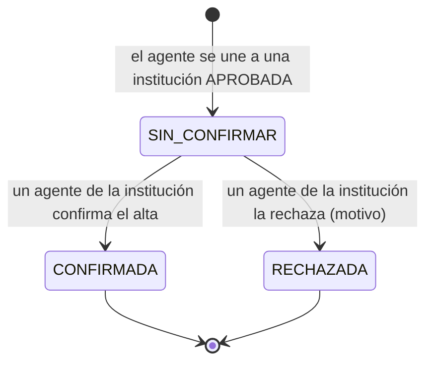

> El **agente fundador** (el que crea la institución) y el que se une a una
> institución **pendiente** nacen confirmados: de la institución decide la
> presidencia al aprobarla. Un agente sin confirmar solo puede ver y completar
> los datos de su institución.

---

## 8. Certificado

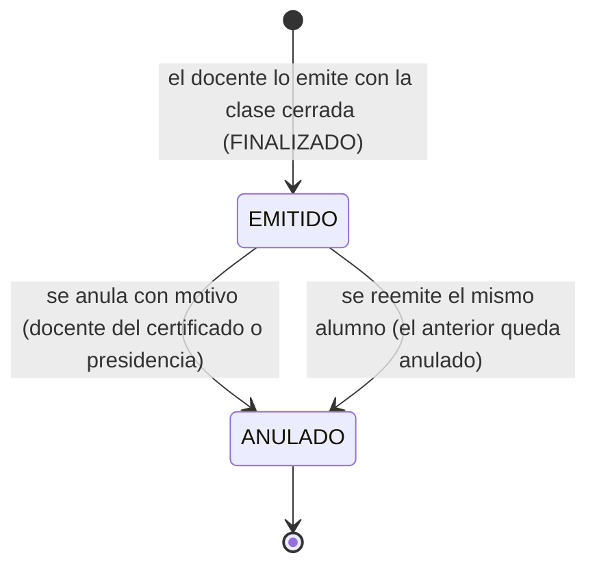

| Estado | Significado |
| --- | --- |
| **Emitido** | El PDF está guardado con su `hash_sha256` y su folio. Es inmutable: cambiar la plantilla después **no** lo altera. |
| **Anulado** | Deja de ser válido en la página pública, con el motivo guardado. El PDF se conserva (es un documento histórico). |

> El **folio** (`CACE-<año>-<consecutivo>`) es único. La **verificación
> pública** (`GET /verificar/:folio?c=<código>`, sin sesión) tiene cuatro
> desenlaces: `VALIDO`, `ANULADO`, `NO_ENCONTRADO` e `INVALIDO`. El código de 8
> caracteres se **deriva** del folio con un HMAC del secreto del servidor, así
> que no se guarda en ninguna columna y los certificados ya emitidos tienen el
> suyo sin reemitirlos. Va dentro del QR.

---

## 9. Solicitud de borrado de institución

El borrado definitivo de una institución **rechazada** tiene dos caminos: la
presidencia lo hace directo, o la secretaría lo **pide** y la presidencia lo
autoriza. La petición queda registrada.

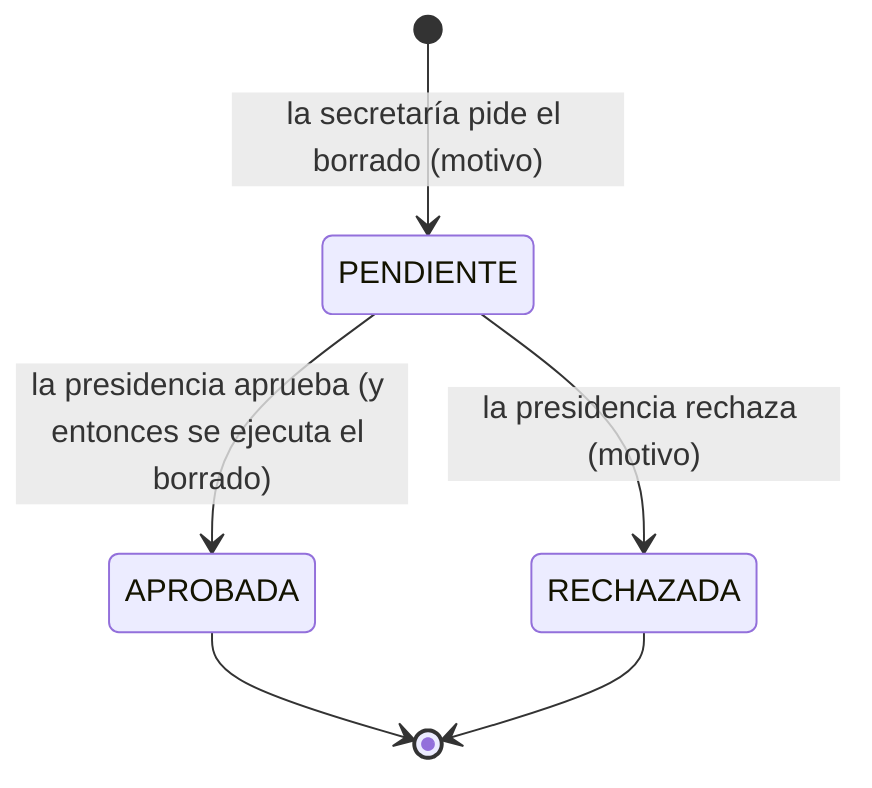

> La solicitud **sobrevive** al borrado de su institución: la columna
> `institucion_id` admite nulos justo para que quede constancia de quién pidió y
> quién autorizó. Solo se puede pedir sobre una institución **rechazada**, y
> solo se resuelve una vez (aprobada o rechazada).

---

## 10. Miembros de la CACE y transmisión de la presidencia

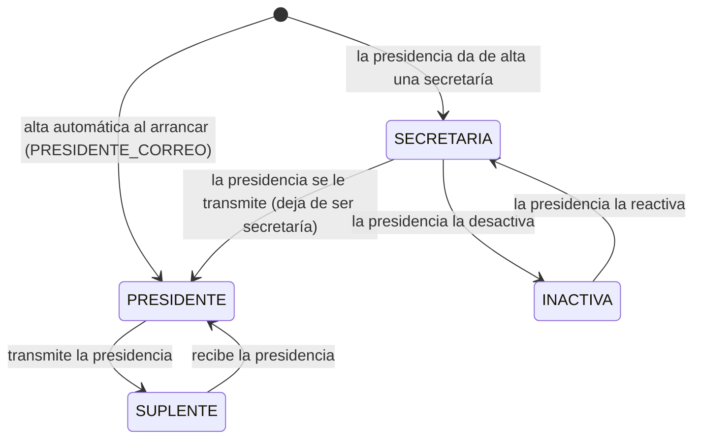

| Cargo (`MIEMBRO_CACE.cargo`) | Qué es |
| --- | --- |
| **PRESIDENTE** | Quien preside la CACE. Hay uno solo a la vez. |
| **SUPLENTE** | Quien dejó la presidencia. **Conserva las capacidades** (presidencia y suplencia comparten rol) y no pierde el acceso. |
| **SECRETARIA** | Ayuda con la imagen y los premios y **pide** el borrado de instituciones; no firma, ni veta, ni aprueba, ni reparte cargos. |

> La presidencia **no se borra ni se desactiva**: se **transmite**. Al transmitirla
> el saliente queda como suplente activo y se escribe una fila en
> `CAMBIO_PRESIDENCIA` con quién salió, quién entró, el motivo y la fecha. Si el
> entrante era secretaría, **deja de serlo**: el cargo de presidencia manda. Los
> cuatro roles del sistema y lo que puede cada uno están en la matriz de
> capacidades (`backend/src/common/capacidades.ts`), que es la fuente única:
> el código pregunta por la **capacidad**, nunca por el nombre del rol.
