# Mapa de pantallas y navegación — Clases Conjuntas (Figura 2.5)

```mermaid
flowchart TD
    %% ============ AUTENTICACIÓN ============
    subgraph AUTH["🔐 Autenticación (sin sesión)"]
        A1(["Iniciar sesión"])
        A2(["Registro del agente:<br/>buscar su institución en el directorio"])
        A2b(["Unirse a la institución elegida<br/>· o · crear una nueva"])
        A3(["Activar cuenta<br/>(docente, por invitación)"])
        A4(["Verificación pública del certificado<br/>/verificar/:folio?c=código"])
    end

    %% ============ PANEL DEL AGENTE ============
    subgraph AGENTE["👔 Panel del Agente de Internacionalización"]
        G1(["Panel principal<br/>(indicadores + comunidad CACE)"])
        G2(["Mi institución<br/>(+ logo y gate de registro)"])
        G3(["Docentes<br/>(invitar / activar / desactivar / eliminar / historial)"])
        G4(["Confirmaciones de alta<br/>(agentes nuevos de mi institución)"])
        G5(["Materias"])
        G6(["Asignaciones<br/>(docente ↔ materia por periodo)"])
        G7(["Solicitudes (revisión)<br/>pendientes / aceptadas / rechazadas"])
        G8(["Clases espejo de la institución"])
        G9(["Reporte de planificación"])
    end

    %% ============ PANEL DEL DOCENTE ============
    subgraph DOCENTE["🧑‍🏫 Panel del Docente"]
        D1(["Panel principal<br/>(indicadores)"])
        D2(["Nueva solicitud"])
        D3(["Mis solicitudes<br/>(estados)"])
        D4(["Mis clases espejo"])
    end

    %% ============ PANEL DE LA CACE ============
    subgraph CACE["🏛 Panel de la CACE (presidencia y secretaría)"]
        K0(["Inicio<br/>(cabecera y cambio de contraseña obligatorio)"])
        K1(["Instituciones<br/>Pendiente / Aprobada / Rechazada / Vetada"])
        K2(["Miembros de la CACE<br/>(altas de secretarías y activar/desactivar)"])
        K3(["Presidencia<br/>(transmitir el cargo + historial de cambios)"])
        K4(["Solicitudes de borrado<br/>(pedir · aprobar · rechazar)"])
        K5(["Personalización<br/>(lema, descripción, logo y temas)"])
        K6(["Comunidad<br/>(países de la CACE)"])
        K7(["Premios y reconocimientos<br/>(borrador o publicado)"])
        K8(["Certificado<br/>(diseño de la plantilla versionada)"])
    end

    %% ============ PROYECTO (CLASE ESPEJO) ============
    subgraph PROYECTO["📘 Pantalla del proyecto (clase espejo)"]
        P1(["Datos del proyecto"])
        P2(["Docentes participantes"])
        P3(["Planificación conjunta<br/>+ confirmación"])
        P4(["Chat del proyecto<br/>(ventana)"])
        P5(["Alumnos<br/>(lista en Excel, CSV o pegado)"])
        P6(["Certificados<br/>(emisión, ZIP, envío y anulación)"])
        P7(["Sesiones<br/>+ reporte de clase y firmas"])
        P8(["Actividades"])
        P9(["Evidencias"])
        P10(["Evaluación final"])
        P11(["Cierre → Finalizado"])
    end

    %% ============ ELEMENTOS COMUNES ============
    subgraph COMUN["🔔 Elementos comunes"]
        C1(["Calendario mensual<br/>(ventana emergente)"])
        C2(["Recordatorios<br/>(lo próximo / por hacer)"])
        C3(["Campana de notificaciones"])
        C4(["Mi perfil y foto"])
        C5(["Ayuda / guía interactiva por apartado"])
        C6(["Comunidad<br/>(países de la CACE y premios publicados)"])
    end

    %% ============ NAVEGACIÓN ============
    A2 --> A2b
    A2b -. "la institución nace Pendiente<br/>y se decide en el panel de la CACE" .-> K1
    A3 --> A1
    A1 -->|"rol agente"| G1
    A1 -->|"rol docente"| D1
    A1 -->|"presidencia / secretaría de la CACE"| K0

    G1 --> G2
    G1 --> G3
    G3 --> G4
    G4 --> G5
    G5 --> G6
    G1 --> G7
    G1 --> G8
    G8 --> G9

    D1 --> D2
    D1 --> D3
    D1 --> D4
    D2 --> D3
    D3 -->|"aprobada por destino<br/>se crea el proyecto"| P1
    D4 --> P1

    K0 --> K1
    K1 --> K4
    K0 --> K2
    K2 --> K3
    K0 --> K5
    K5 --> K6
    K0 --> K7
    K0 --> K8
    K4 --> K1

    P1 --> P2
    P1 --> P3
    P1 --> P4
    P1 --> P5
    P5 --> P6
    P1 --> P7
    P1 --> P8
    P1 --> P9
    P1 --> P10
    P10 --> P11
    P11 -->|"con la clase cerrada<br/>se habilitan"| P6
    P6 -->|"el QR lleva al enlace"| A4

    G1 -.-> C1
    D1 -.-> C1
    K0 -.-> C1
    G1 -.-> C2
    D1 -.-> C2
    K0 -.-> C2
    G1 -.-> C3
    D1 -.-> C3
    K0 -.-> C3
    G1 -.-> C4
    D1 -.-> C4
    K0 -.-> C4
    G1 -.-> C5
    D1 -.-> C5
    K0 -.-> C5
    G1 -.-> C6
    D1 -.-> C6

    %% ============ ESTILOS ============
    classDef auth fill:#F1F5F9,stroke:#64748B,color:#1E293B
    classDef agente fill:#DBEAFE,stroke:#2563EB,color:#1E3A8A
    classDef docente fill:#DCFCE7,stroke:#16A34A,color:#14532D
    classDef cace fill:#E0E7FF,stroke:#4F46E5,color:#312E81
    classDef proyecto fill:#EDE9FE,stroke:#7C3AED,color:#4C1D95
    classDef comun fill:#FEF3C7,stroke:#D97706,color:#78350F

    class A1,A2,A2b,A3,A4 auth
    class G1,G2,G3,G4,G5,G6,G7,G8,G9 agente
    class D1,D2,D3,D4 docente
    class K0,K1,K2,K3,K4,K5,K6,K7,K8 cace
    class P1,P2,P3,P4,P5,P6,P7,P8,P9,P10,P11 proyecto
    class C1,C2,C3,C4,C5,C6 comun
```

---

## Notas sobre las pantallas

* **La presidencia y la secretaría comparten panel** (`/cace`): es la misma
  pantalla y el mismo menú, pero las entradas se **esconden** según las
  capacidades que devuelve `GET /cace/capacidades`. La secretaría no ve
  «Instituciones» (`aprobarInstituciones`), ni «Miembros» ni «Presidencia»
  (`gestionarMiembrosCace`), ni «Certificado» (`disenarCertificados` /
  `firmarCertificados`); sí ve «Solicitudes de borrado» (con su parte: pedir),
  «Personalización», «Comunidad» y «Premios».
* **Páginas propias del panel de la CACE.** «Personalización»
  (`/cace/personalizacion`) y «Certificado» (`/cace/certificado`) tienen ruta
  propia, para que el enlace se pueda compartir y para no cargar el panel
  general.
* **Cambio de contraseña obligatorio.** En «Inicio» del panel de la CACE, si la
  cuenta tiene `debeCambiarPassword`, lo único que se ve es el formulario de
  cambio: es el acceso del presidente y de las secretarías recién creadas.
* **La lista de alumnos y los certificados solo los ve el docente**: son dos
  secciones de la pantalla del proyecto (`#alumnos` y `#certificados`) que el
  agente no tiene. La emisión está deshabilitada mientras la clase no esté
  **Finalizada**, y la pantalla explica qué falta.
* **La verificación pública está fuera del esqueleto** (sin menú, sin sesión):
  es la página que abre el QR impreso en el certificado y la puede abrir
  cualquiera.
* **La campana** de la barra superior reúne lo que espera decisión. En los paneles
  de agente y docente se llena con la agenda (`GET /recordatorios`: solicitudes
  por vencer, sesiones próximas y tareas pendientes); en el panel de la CACE la
  llena la propia pantalla con las **instituciones pendientes de decisión**, y al
  pulsarla baja a la sección correspondiente.
