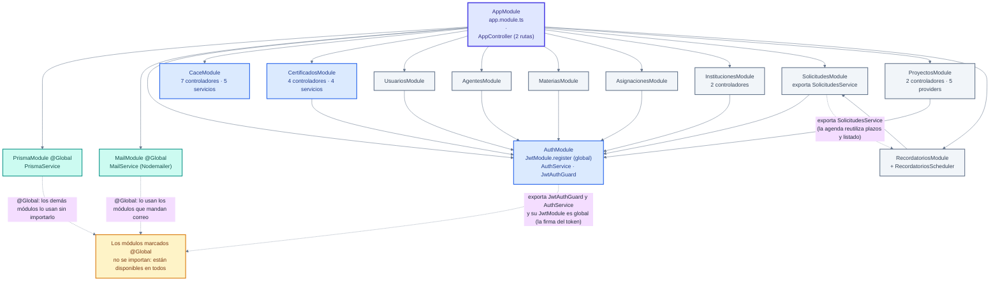

# 🧱 Módulos del backend y sus endpoints

Los módulos de NestJS leídos de `backend/src/**/*.module.ts`, con sus
dependencias, y la lista completa de rutas leída de los controladores
(`backend/src/**/*.controller.ts`).

**Total: 127 rutas en 23 controladores** (22 archivos `.controller.ts`;
`instituciones.controller.ts` contiene dos clases). Es la misma cifra que
documenta el README, y cuadra porque se cuentan igual: cada decorador
`@Get`, `@Post`, `@Put`, `@Patch` o `@Delete`.

---

## 1. Módulos y dependencias



### 1.1 Lo que dice el diagrama

| Módulo | Archivo | Importa | Exporta / aporta |
| --- | --- | --- | --- |
| `AppModule` | `app.module.ts` | los 13 módulos restantes | `AppController` (2 rutas) y `AppService`. |
| `PrismaModule` | `prisma/prisma.module.ts` | — | `PrismaService` **`@Global`**: es el acceso a la base y omite `passwordHash` salvo que se pida. |
| `MailModule` | `mail/mail.module.ts` | — | `MailService` **`@Global`** (Nodemailer). |
| `AuthModule` | `auth/auth.module.ts` | `JwtModule.register` (global) | `AuthService` y `JwtAuthGuard`. **Sin `JWT_SECRET` de 16+ caracteres el módulo lanza y el servidor no arranca.** |
| `UsuariosModule` | `usuarios/usuarios.module.ts` | `AuthModule` | Perfil, contraseña y foto. |
| `AgentesModule` | `agentes/agentes.module.ts` | `AuthModule` | Docentes de la institución y confirmaciones de alta. |
| `MateriasModule` | `materias/materias.module.ts` | `AuthModule` | CRUD de materias. |
| `AsignacionesModule` | `asignaciones/asignaciones.module.ts` | `AuthModule` | Docente ↔ materia por periodo. |
| `InstitucionesModule` | `instituciones/instituciones.module.ts` | `AuthModule` | `InstitucionesController` (con guardia) y `DirectorioInstitucionesController` (**sin** guardia). |
| `SolicitudesModule` | `solicitudes/solicitudes.module.ts` | `AuthModule` | **Exporta `SolicitudesService`** para el módulo de recordatorios. |
| `ProyectosModule` | `proyectos/proyectos.module.ts` | `AuthModule` | `ProyectosService`, `ResumenPdfService`, `CalendarioIcsService`, `ListasAlumnosService` y `DocenteParticipanteGuard`. |
| `RecordatoriosModule` | `recordatorios/recordatorios.module.ts` | **`SolicitudesModule`** | `RecordatoriosService` y `RecordatoriosScheduler` (la caducidad y la agenda). |
| `CaceModule` | `cace/cace.module.ts` | *(ninguno)* | 7 controladores y 5 servicios; usa `PrismaModule` y `MailModule` globales. |
| `CertificadosModule` | `certificados/certificados.module.ts` | `AuthModule` | 4 controladores y 4 servicios (plantilla, emisión, PDF, verificación). |

> **CaceModule no importa `AuthModule`** a propósito y no es un olvido: sus
> controladores usan `JwtAuthGuard` y `CapacidadesGuard` directamente, y
> `JwtModule` ya es global. El módulo de certificados sí lo importa.
>
> **Certificados va en su propio módulo** y no dentro de `CaceModule` ni de
> `ProyectosModule` porque son **dos permisos en dos pantallas distintas**: la
> plantilla la diseña la presidencia (`disenarCertificados`) y la emisión la hace
> el docente (`emitirCertificados`). En un módulo compartido, las guardias de uno
> acabarían aplicándose al otro.

---

## 2. Resumen: cuántas rutas tiene cada módulo

| Módulo | Controladores (clases) | Rutas | Prefijos |
| --- | --- | ---: | --- |
| `AppModule` | 1 (`AppController`) | **2** | `/`, `/health` |
| `AuthModule` | 1 | **4** | `/auth` |
| `UsuariosModule` | 1 | **4** | `/usuarios` |
| `AgentesModule` | 1 | **8** | `/agentes` |
| `MateriasModule` | 1 | **5** | `/materias` |
| `AsignacionesModule` | 1 | **4** | `/asignaciones` |
| `InstitucionesModule` | 2 | **7** | `/instituciones` |
| `SolicitudesModule` | 1 | **6** | `/solicitudes` |
| `ProyectosModule` | 2 | **37** | `/proyectos` |
| `RecordatoriosModule` | 1 | **1** | `/recordatorios` |
| `CaceModule` | 7 | **31** | `/cace` |
| `CertificadosModule` | 4 | **15** | `/proyectos/:id/certificados`, `/cace/certificados`, `/verificar` |
| **Total** | **23** | **127** | |

**Cómo se cuentan** (el mismo comando sirve para volver a comprobarlo):

```powershell
Select-String -Path (Get-ChildItem backend\src -Recurse -Filter *.controller.ts).FullName `
  -Pattern '@(Get|Post|Put|Patch|Delete)\(' | Measure-Object
```

---

## 3. Endpoints por módulo

En la columna **Guarda** se indica lo que exige cada ruta, leído de los
controladores: `JWT` (solo estar autenticado), `JWT + capacidad` (además pasa por
`CapacidadesGuard` con `@Requiere(...)`), `público` (sin guardia) o la guardia
propia que se indique.

### 3.1 `AppModule` — 2 rutas

| Método | Ruta | Guarda |
| --- | --- | --- |
| `GET` | `/` | público (con el frontend compilado devuelve el `index.html`) |
| `GET` | `/health` | público |

### 3.2 `AuthModule` — 4 rutas

| Método | Ruta | Guarda |
| --- | --- | --- |
| `POST` | `/auth/register` | público |
| `POST` | `/auth/login` | público + `RateLimitGuard` |
| `GET` | `/auth/activate` | público |
| `POST` | `/auth/activate` | público + `RateLimitGuard` |

### 3.3 `UsuariosModule` — 4 rutas

| Método | Ruta | Guarda |
| --- | --- | --- |
| `GET` | `/usuarios/me` | JWT |
| `POST` | `/usuarios/me/password` | JWT |
| `POST` | `/usuarios/me/foto` | JWT |
| `DELETE` | `/usuarios/me/foto` | JWT |

### 3.4 `AgentesModule` — 8 rutas

| Método | Ruta | Guarda |
| --- | --- | --- |
| `POST` | `/agentes/invitar-docente` | JWT |
| `GET` | `/agentes/docentes` | JWT |
| `PATCH` | `/agentes/docentes/:id/estado` | JWT |
| `DELETE` | `/agentes/docentes/:id` | JWT |
| `GET` | `/agentes/docentes/:id/historial` | JWT |
| `GET` | `/agentes/confirmaciones` | JWT + `confirmarAgenteInstitucion` |
| `POST` | `/agentes/confirmaciones/:id/confirmar` | JWT + `confirmarAgenteInstitucion` |
| `POST` | `/agentes/confirmaciones/:id/rechazar` | JWT + `confirmarAgenteInstitucion` |

### 3.5 `MateriasModule` — 5 rutas

| Método | Ruta | Guarda |
| --- | --- | --- |
| `GET` | `/materias` | JWT |
| `GET` | `/materias/:id` | JWT |
| `POST` | `/materias` | JWT |
| `PATCH` | `/materias/:id` | JWT |
| `DELETE` | `/materias/:id` | JWT |

### 3.6 `AsignacionesModule` — 4 rutas

| Método | Ruta | Guarda |
| --- | --- | --- |
| `GET` | `/asignaciones` | JWT |
| `GET` | `/asignaciones/mias` | JWT |
| `POST` | `/asignaciones` | JWT |
| `DELETE` | `/asignaciones/:id` | JWT |

### 3.7 `InstitucionesModule` — 7 rutas

| Método | Ruta | Guarda | Controlador |
| --- | --- | --- | --- |
| `GET` | `/instituciones` | JWT | `InstitucionesController` |
| `GET` | `/instituciones/mia` | JWT | `InstitucionesController` |
| `GET` | `/instituciones/:id/materias` | JWT | `InstitucionesController` |
| `PATCH` | `/instituciones/mia` | JWT | `InstitucionesController` |
| `POST` | `/instituciones/mia/logo` | JWT | `InstitucionesController` |
| `DELETE` | `/instituciones/mia/logo` | JWT | `InstitucionesController` |
| `GET` | `/instituciones/directorio` | **público** | `DirectorioInstitucionesController` |

> El directorio va sin guardia a propósito: quien se está registrando **todavía no
> tiene cuenta** y es justo quien tiene que buscar su institución antes de crear
> una nueva.

### 3.8 `SolicitudesModule` — 6 rutas

| Método | Ruta | Guarda |
| --- | --- | --- |
| `POST` | `/solicitudes` | JWT |
| `GET` | `/solicitudes/mias` | JWT |
| `GET` | `/solicitudes/entrantes` | JWT |
| `POST` | `/solicitudes/:id/revisar` | JWT |
| `PATCH` | `/solicitudes/:id` | JWT |
| `DELETE` | `/solicitudes/:id` | JWT |

### 3.9 `ProyectosModule` — 37 rutas

`ProyectosController` (32):

| Método | Ruta | Guarda |
| --- | --- | --- |
| `GET` | `/proyectos/mios` | JWT |
| `GET` | `/proyectos/institucion` | JWT |
| `GET` | `/proyectos/:id` | JWT |
| `GET` | `/proyectos/:id/resumen-pdf` | JWT |
| `GET` | `/proyectos/:id/calendario.ics` | JWT |
| `POST` | `/proyectos/:id/calendario/enviar` | JWT |
| `GET` | `/proyectos/:id/mensajes` | JWT |
| `POST` | `/proyectos/:id/mensajes` | JWT |
| `PATCH` | `/proyectos/:id` | JWT |
| `POST` | `/proyectos/:id/docentes` | JWT |
| `DELETE` | `/proyectos/:id/docentes/:proyectoDocenteId` | JWT |
| `PUT` | `/proyectos/:id/planificacion` | JWT |
| `POST` | `/proyectos/:id/planificacion/confirmar` | JWT |
| `GET` | `/proyectos/:id/reportes` | JWT |
| `POST` | `/proyectos/:id/reportes` | JWT |
| `GET` | `/proyectos/:id/sesiones` | JWT |
| `POST` | `/proyectos/:id/sesiones` | JWT |
| `PATCH` | `/proyectos/:id/sesiones/:sesionId` | JWT |
| `DELETE` | `/proyectos/:id/sesiones/:sesionId` | JWT |
| `GET` | `/proyectos/:id/actividades` | JWT |
| `POST` | `/proyectos/:id/actividades` | JWT |
| `PATCH` | `/proyectos/:id/actividades/:actividadId` | JWT |
| `DELETE` | `/proyectos/:id/actividades/:actividadId` | JWT |
| `GET` | `/proyectos/:id/evidencias` | JWT |
| `POST` | `/proyectos/:id/evidencias` | JWT + `DocenteParticipanteGuard` |
| `GET` | `/proyectos/:id/reportes-clase` | JWT |
| `GET` | `/proyectos/:id/sesiones/:sesionId/reporte` | JWT |
| `PUT` | `/proyectos/:id/sesiones/:sesionId/reporte` | JWT |
| `POST` | `/proyectos/:id/reportes-clase/:reporteId/confirmar` | JWT |
| `GET` | `/proyectos/:id/evaluaciones` | JWT |
| `POST` | `/proyectos/:id/evaluaciones` | JWT |
| `POST` | `/proyectos/:id/cerrar` | JWT |

`ListasAlumnosController` (5):

| Método | Ruta | Guarda |
| --- | --- | --- |
| `GET` | `/proyectos/:id/listas-alumnos` | JWT |
| `POST` | `/proyectos/:id/listas-alumnos/previsualizar` | JWT |
| `PUT` | `/proyectos/:id/listas-alumnos` | JWT |
| `PATCH` | `/proyectos/:id/listas-alumnos/alumnos/:alumnoId` | JWT |
| `DELETE` | `/proyectos/:id/listas-alumnos/alumnos/:alumnoId` | JWT |

> Las rutas del proyecto exigen JWT en la guardia de clase, pero **quién puede
> qué** lo decide el servicio (`obtenerConAcceso`, `exigirDocenteParticipante`,
> `exigirAgenteDeLaInstitucion`): es la **autorización por pertenencia**, no una
> capacidad. La única guardia adicional es la de evidencias.

### 3.10 `RecordatoriosModule` — 1 ruta

| Método | Ruta | Guarda |
| --- | --- | --- |
| `GET` | `/recordatorios` | JWT |

### 3.11 `CaceModule` — 31 rutas

`CapacidadesCaceController` (1):

| Método | Ruta | Guarda |
| --- | --- | --- |
| `GET` | `/cace/capacidades` | JWT (sin `@Requiere`: devuelve lo que el usuario puede hacer) |

`InstitucionesCaceController` (6):

| Método | Ruta | Guarda |
| --- | --- | --- |
| `GET` | `/cace/instituciones` | JWT + `aprobarInstituciones` |
| `POST` | `/cace/instituciones/:id/aprobar` | JWT + `aprobarInstituciones` |
| `POST` | `/cace/instituciones/:id/rechazar` | JWT + `aprobarInstituciones` |
| `POST` | `/cace/instituciones/:id/vetar` | JWT + `aprobarInstituciones` |
| `POST` | `/cace/instituciones/:id/reactivar` | JWT + `aprobarInstituciones` |
| `DELETE` | `/cace/instituciones/:id` | JWT + `borrarInstituciones` |

`IdentidadCaceController` (14):

| Método | Ruta | Guarda |
| --- | --- | --- |
| `GET` | `/cace/configuracion` | JWT + `personalizarCace` |
| `PATCH` | `/cace/configuracion` | JWT + `personalizarCace` |
| `POST` | `/cace/configuracion/logo` | JWT + `personalizarCace` |
| `DELETE` | `/cace/configuracion/logo` | JWT + `personalizarCace` |
| `GET` | `/cace/paises` | JWT + `personalizarCace` |
| `POST` | `/cace/paises` | JWT + `personalizarCace` |
| `PATCH` | `/cace/paises/:id` | JWT + `personalizarCace` |
| `DELETE` | `/cace/paises/:id` | JWT + `personalizarCace` |
| `GET` | `/cace/premios` | JWT + `publicarPremios` |
| `POST` | `/cace/premios` | JWT + `publicarPremios` |
| `PATCH` | `/cace/premios/:id` | JWT + `publicarPremios` |
| `DELETE` | `/cace/premios/:id` | JWT + `publicarPremios` |
| `POST` | `/cace/premios/:id/imagen` | JWT + `publicarPremios` |
| `DELETE` | `/cace/premios/:id/imagen` | JWT + `publicarPremios` |

`IdentidadCacePublicaController` (2):

| Método | Ruta | Guarda |
| --- | --- | --- |
| `GET` | `/cace/publico` | **público** |
| `GET` | `/cace/premios-publicos` | **público** |

`MiembrosCaceController` (3):

| Método | Ruta | Guarda |
| --- | --- | --- |
| `GET` | `/cace/miembros` | JWT + `gestionarMiembrosCace` |
| `POST` | `/cace/miembros` | JWT + `gestionarMiembrosCace` |
| `PATCH` | `/cace/miembros/:id` | JWT + `gestionarMiembrosCace` |

`PresidenciaCaceController` (2):

| Método | Ruta | Guarda |
| --- | --- | --- |
| `POST` | `/cace/presidencia/cambiar` | JWT + `gestionarMiembrosCace` |
| `GET` | `/cace/presidencia/historial` | JWT + `gestionarMiembrosCace` |

`SolicitudesBorradoController` (3):

| Método | Ruta | Guarda |
| --- | --- | --- |
| `POST` | `/cace/instituciones/:id/solicitud-borrado` | JWT + `solicitarBorradoInstitucion` |
| `GET` | `/cace/solicitudes-borrado` | JWT (sin `@Requiere`) |
| `PATCH` | `/cace/solicitudes-borrado/:id` | JWT + `resolverSolicitudesBorrado` |

### 3.12 `CertificadosModule` — 15 rutas

`PlantillasCertificadoController` (6):

| Método | Ruta | Guarda |
| --- | --- | --- |
| `GET` | `/cace/certificados/plantilla` | JWT + `disenarCertificados` |
| `GET` | `/cace/certificados/plantilla/qr` | JWT + `disenarCertificados` |
| `POST` | `/cace/certificados/plantilla` | JWT + `disenarCertificados` |
| `POST` | `/cace/certificados/plantilla/fondo` | JWT + `disenarCertificados` |
| `PATCH` | `/cace/certificados/plantilla/:id/activar` | JWT + `disenarCertificados` |
| `DELETE` | `/cace/certificados/plantilla/:id` | JWT + `disenarCertificados` |

`CertificadosCaceController` (1):

| Método | Ruta | Guarda |
| --- | --- | --- |
| `POST` | `/cace/certificados/:certificadoId/anular` | JWT + `anularCertificados` |

`CertificadosController` (7):

| Método | Ruta | Guarda |
| --- | --- | --- |
| `GET` | `/proyectos/:id/certificados` | JWT + `emitirCertificados` |
| `POST` | `/proyectos/:id/certificados/emitir` | JWT + `emitirCertificados` |
| `GET` | `/proyectos/:id/certificados/zip` | JWT + `emitirCertificados` |
| `POST` | `/proyectos/:id/certificados/enviar` | JWT + `emitirCertificados` |
| `POST` | `/proyectos/:id/certificados/:certificadoId/enviar` | JWT + `emitirCertificados` |
| `POST` | `/proyectos/:id/certificados/:certificadoId/anular` | JWT + `anularCertificados` |
| `GET` | `/proyectos/:id/certificados/:certificadoId/pdf` | JWT + `emitirCertificados` |

`VerificacionController` (1):

| Método | Ruta | Guarda |
| --- | --- | --- |
| `GET` | `/verificar/:folio` | **público** (es lo que abre el QR del certificado) |

---

## 4. Comprobaciones que no son "un módulo"

| Pieza | Dónde | Qué hace |
| --- | --- | --- |
| `JwtAuthGuard` | `auth/jwt-auth.guard.ts` | Valida el token de sesión. Además comprueba en **cada** petición que la cuenta siga activa. |
| `CapacidadesGuard` + `@Requiere('…')` | `auth/capacidades.guard.ts` | Comprueba la **capacidad**, no el nombre del rol, con la matriz de `common/capacidades.ts`. Sin `@Requiere`, la ruta solo exige estar autenticado. |
| `DocenteParticipanteGuard` | `proyectos/guards/docente-participante.guard.ts` | Exige ser docente participante de esa clase espejo (lo usa la subida de evidencias). |
| `RateLimitGuard` | `common/guards/rate-limit.guard.ts` | Límite de intentos **en memoria**. Hoy solo está puesto en `POST /auth/login` y `POST /auth/activate`. |
| `PrismaExceptionFilter` | `common/filters/prisma-exception.filter.ts` | Convierte los errores de integridad de Prisma en respuestas legibles. Se registra global en `main.ts`. |
| `ValidationPipe({ whitelist: true, transform: true })` | `main.ts` | Valida y recorta los DTO en todas las rutas. |
| `RecordatoriosScheduler` | `recordatorios/recordatorios.scheduler.ts` | Trabajo programado: agenda y caducidad de solicitudes. |
| Prefijos de la API para el *fallback* SPA | `main.ts` | Se derivan del router de NestJS al arrancar (más una lista conocida). **Un módulo nuevo no queda tapado por el `index.html`.** |

---

## 5. Notas

* **Ninguna ruta se documenta dos veces.** Las 127 de este documento son las
  mismas que están en las tablas del README; si se añade una ruta, hay que
  actualizar los dos sitios (y el conteo del README).
* **Diez de las 127 rutas no llevan JWT**: `/`, `/health`, las cuatro de `auth`
  (registro, login y la activación, que son la puerta de entrada),
  `GET /instituciones/directorio` (el que se usa **mientras** se está
  registrando), `GET /cace/publico`, `GET /cace/premios-publicos` (lo que la
  pantalla de acceso necesita antes de que nadie entre) y `GET /verificar/:folio`
  (lo que abre el QR impreso).
* **`GET /cace/capacidades`** es la ruta que alimenta a la interfaz para
  **esconder** lo que el rol no puede hacer. Esconder un botón no es seguridad:
  el servidor vuelve a comprobar cada capacidad en su ruta.
* **Puertos y prefijos no son lo mismo.** El puerto es uno (el de NestJS, `3000`
  por defecto); los prefijos son los trece de la tabla del apartado 2. El detalle
  de qué se sirve por dónde está en [`arquitectura.md`](arquitectura.md).
