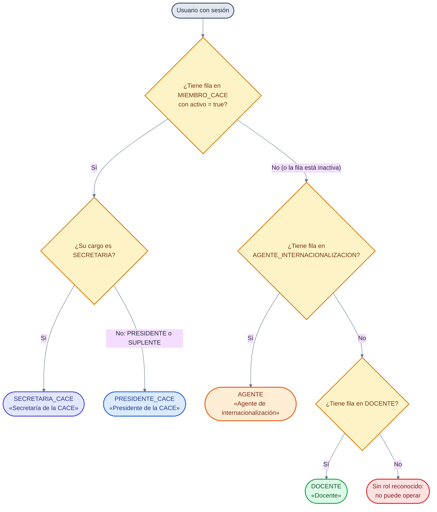
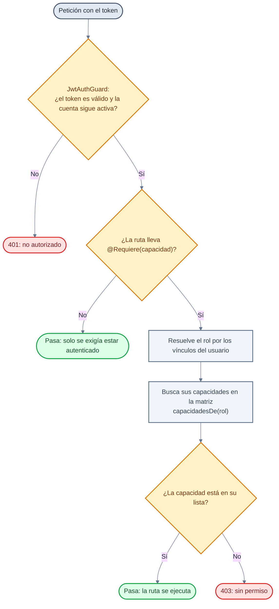

# 🔐 Roles y capacidades (matriz de permisos)

Lo que decide **no es el rol, sino la capacidad**. La fuente única es
`backend/src/common/capacidades.ts`: 4 roles, **12 capacidades** y una matriz que
dice qué tiene cada rol. El código pregunta siempre por la capacidad
(`@Requiere('…')`), nunca por el nombre del rol.

---

## 1. Cómo se resuelve el rol (no es una columna)

El rol **se deduce de las filas relacionales**. No existe `Usuario.rol`.

**El orden importa**: primero manda la CACE, después el agente y al final el
docente. Si alguien tuviera fila de agente y de miembro de la CACE a la vez,
**gana la CACE**.

> **La suplencia no es un rol aparte.** Una fila con `cargo = SUPLENTE` resuelve
> al mismo rol que la presidencia (`PRESIDENTE_CACE`) porque la comparación es
> `cargo === 'SECRETARIA' ? SECRETARIA_CACE : PRESIDENTE_CACE`. Por eso el
> suplente **conserva todas las capacidades** y no pierde el acceso.
>
> **Una fila inactiva no cuenta.** Si el miembro de la CACE tiene
> `activo = false`, se sigue mirando hacia abajo (agente, docente). Y como el rol
> es relacional, desactivar a alguien en la CACE no borra su fila: deja de
> contar.

---

## 2. Cómo se comprueba una capacidad

---

## 3. La matriz: rol × capacidad

Leída de `MATRIZ` en `backend/src/common/capacidades.ts`. El nombre entre
paréntesis es el que se escribe en `@Requiere('…')`.

| Capacidad (`@Requiere(…)`) | Qué permite | Docente | Agente | Presidencia (y suplencia) | Secretaría |
| --- | --- | :---: | :---: | :---: | :---: |
| `aprobarInstituciones` | Aprobar, rechazar, vetar y reactivar instituciones | ❌ | ❌ | ✅ | ❌ |
| `borrarInstituciones` | Borrar definitivamente una institución rechazada, sin autorización previa | ❌ | ❌ | ✅ | ❌ |
| `solicitarBorradoInstitucion` | **Pedir** el borrado de una institución rechazada | ❌ | ❌ | ❌ | ✅ |
| `resolverSolicitudesBorrado` | Aprobar o rechazar esas solicitudes (al aprobar, se ejecuta el borrado) | ❌ | ❌ | ✅ | ❌ |
| `gestionarMiembrosCace` | Dar de alta secretarías, activarlas/desactivarlas y **transmitir la presidencia** | ❌ | ❌ | ✅ | ❌ |
| `confirmarAgenteInstitucion` | Dar por bueno el alta de un agente nuevo en una institución ya aprobada | ❌ | ✅ | ❌ | ❌ |
| `personalizarCace` | Logo, textos, banderas (países) y tema de la CACE | ❌ | ❌ | ✅ | ✅ |
| `publicarPremios` | Premios y reconocimientos | ❌ | ❌ | ✅ | ✅ |
| `disenarCertificados` | Crear y editar la plantilla del certificado | ❌ | ❌ | ✅ | ❌ |
| `firmarCertificados` | Firmar los certificados emitidos | ❌ | ❌ | ✅ | ❌ |
| `emitirCertificados` | Emitir los certificados de sus alumnos, descargarlos y enviarlos | ✅ | ❌ | ❌ | ❌ |
| `anularCertificados` | Anular un certificado emitido, con motivo | ✅ | ❌ | ✅ | ❌ |
| **Total por rol** | | **2** | **1** | **9** | **3** |

### 3.1 Las capacidades, una por una, según el archivo

| Rol | Capacidades, en el orden en que aparecen en la matriz |
| --- | --- |
| `DOCENTE` | `emitirCertificados`, `anularCertificados` |
| `AGENTE` | `confirmarAgenteInstitucion` |
| `PRESIDENTE_CACE` | `aprobarInstituciones`, `borrarInstituciones`, `resolverSolicitudesBorrado`, `gestionarMiembrosCace`, `personalizarCace`, `publicarPremios`, `disenarCertificados`, `firmarCertificados`, `anularCertificados` |
| `SECRETARIA_CACE` | `personalizarCace`, `publicarPremios`, `solicitarBorradoInstitucion` |

**Rasgos del reparto**

* **La secretaría no manda**: ayuda con la imagen y los premios, y **pide** el
  borrado. No aprueba, no veta, no reparte cargos, no diseña ni firma la
  plantilla y no emite certificados.
* **La presidencia tiene las nueve** capacidades de gobierno, incluida
  `anularCertificados` (responde por lo que firma la CACE).
* **El docente es el único que emite.** Ni la presidencia emite: solo diseña,
  firma y puede anular.
* **`firmarCertificados` es la única capacidad que no exige ninguna ruta.** Se
  reparte en la matriz (la tiene la presidencia) y la firma queda como dato de la
  plantilla (`PlantillaCertificado.firmaNombre`), pero **ningún
  `@Requiere('firmarCertificados')` aparece hoy en los controladores**: las rutas
  de la plantilla piden `disenarCertificados`. Las otras once capacidades sí se
  exigen en al menos una ruta.
* `borrarInstituciones` y `resolverSolicitudesBorrado` son **dos caminos al
  mismo borrado**: directo (presidencia) o autorizado (la secretaría pide, la
  presidencia aprueba).

---

## 4. Lo que **no** es una capacidad

Hay acciones del flujo que no pasan por la matriz, porque no son un permiso de
rol sino **pertenencia a un recurso**: el servicio comprueba si el usuario es
docente participante de esa clase espejo, agente de esa institución, dueño de esa
solicitud… Esta tabla **no sale de `capacidades.ts`**: es la que documenta el
README (`docs/README.md`, «Matriz de permisos») y se reproduce aquí para que la
frontera quede clara.

| Acción | Docente | Agente |
| --- | :---: | :---: |
| Ver y editar su institución (y su logo) | ❌ | ✅ |
| Invitar, activar/desactivar y eliminar docentes | ❌ | ✅ |
| Crear y editar materias y asignaciones | ❌ | ✅ |
| Crear una solicitud de clase espejo | ✅ | ❌ |
| Editar o cancelar su propia solicitud (en `PENDIENTE` o `RECHAZADA`) | ✅ | ❌ |
| Revisar solicitudes (aprobar o rechazar con motivo) | ❌ | ✅ |
| Ver el proyecto y **todos** sus detalles | ✅ | ✅ (consulta) |
| Agregar o quitar docentes del proyecto | ❌ | ✅ (solo los de su institución) |
| Datos del proyecto, planificación, sesiones, actividades, evidencias | ✅ | ❌ |
| Chat del proyecto | ✅ | ❌ |
| Reporte de clase conjunto y firmas | ✅ | ❌ |
| Evaluación final y cierre | ✅ | ❌ |
| Reporte de planificación | ❌ | ✅ (supervisión) |
| Lista de alumnos y certificados (emisión, ZIP y envío) | ✅ | ❌ |

> **El agente ve la clase, pero no la conduce.** Puede consultar el proyecto y
> agregar o quitar **solo los docentes de su institución**; organizar la clase
> (planificación, sesiones, actividades, evidencias, reporte y evaluación) es de
> los **docentes participantes**. El reporte de planificación sí es del agente,
> como función de supervisión.

---

## 5. Notas

* **La interfaz esconde, el servidor comprueba.** `GET /cace/capacidades`
  devuelve el rol y las capacidades del usuario que está dentro; la interfaz las
  usa para **no pintar** lo que el rol no puede hacer (la secretaría no ve
  «Instituciones», ni «Miembros», ni «Presidencia», ni «Certificado»). Eso es
  comodidad, **no seguridad**: cada ruta vuelve a comprobar con
  `CapacidadesGuard`.
* **Añadir un permiso es añadir una fila** a la matriz, no buscar comparaciones
  de rol por el código. Ese era el problema que resolvió esta tabla.
* **Solo hay cuatro roles** en `ROLES`: `DOCENTE`, `AGENTE`, `PRESIDENTE_CACE` y
  `SECRETARIA_CACE`. `SUPLENTE` es un **cargo** dentro de `MIEMBRO_CACE`, no un
  rol.
* **Un usuario sin rol reconocido no pasa ninguna capacidad**: `capacidadesDe()`
  devuelve una lista vacía si el rol no se reconoce.
* Las etiquetas que se muestran en la interfaz están en el mismo archivo
  (`ETIQUETA_ROL`), para que no haya cuatro textos distintos según la pantalla.
