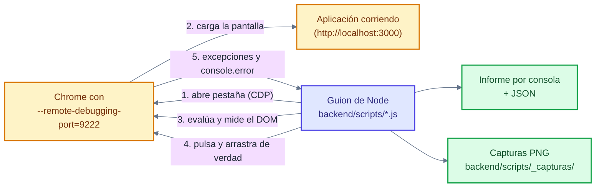

# 🧪 Pruebas y verificaciones

Mapa de **lo que se ha verificado y cómo**, con la evidencia de cada cosa. No es
un plan de pruebas ni una suite: es el inventario honesto de lo comprobado, con
las herramientas que existen hoy en el repositorio.

> **Advertencia sobre las fuentes.** Las cifras y los resultados de este
> documento salen de los informes del repositorio
> (`docs/informes/informe-de-actividades.md`, `docs/auditorias/*`) y de leer las
> herramientas que están en `backend/scripts/`. Se distingue en todo momento
> entre **documentado**, **verificado al escribir esto** y **no verificado**.
> El propio informe de actividades (§12.3) avisa de que los informes de auditoría
> **no llevan fecha fiable**.

---

## 1. Compilaciones y comprobaciones estáticas

| # | Qué comprueba | Comando | Resultado documentado | Dónde consta |
| --- | --- | --- | --- | --- |
| 1 | Esquema de base de datos válido | `npx prisma validate` | ✅ *The schema at prisma\schema.prisma is valid* | Informe de actividades §10.1 |
| 2 | El backend compila | `npm run build` → **`nest build`** | ✅ Sin errores (exit 0) | Informe §10.1; respuesta a la auditoría v4 §4 |
| 3 | El frontend no tiene errores de tipos | `npx tsc -p tsconfig.app.json --noEmit` | ✅ Exit 0 | Informe §10.1 |
| 4 | El frontend compila a producción | `npm run build` → **`ng build`** (salida en `backend/public`) | ✅ `nest build` y `ng build` | Respuesta a la auditoría v4 §4 |
| 5 | Las migraciones cubren el esquema | `npx prisma migrate diff --from-migrations … --to-schema-datamodel … --script` | ✅ 22/22 tablas y 0 columnas sin cubrir *(contra las 22 tablas de entonces)* | Informe §10.1 |
| 6 | Consistencia de la documentación | Verificación de los 103 enlaces internos | ✅ 0 enlaces rotos | Informe §10.1 |
| 7 | Codificación de caracteres | Búsqueda de texto corrupto en los documentos | ✅ 0 ocurrencias | Informe §10.1 |

**Verificado al escribir este documento (2026-10-13, árbol limpio en `8ad7f50`):**

| Comando | Resultado |
| --- | --- |
| `npx tsc -p tsconfig.app.json --noEmit` (desde `frontend/`) | **exit 0** — sin errores de tipos |
| `npx tsc -p tsconfig.json --noEmit` (desde `backend/`) | **exit 0** — sin errores de tipos |

> `ngc` (el compilador de plantillas de Angular) existe en
> `frontend/node_modules/.bin/ngc` (viene con `@angular/compiler-cli`), pero **no
> hay constancia de que se haya ejecutado a mano**: la comprobación de plantillas
> va dentro de `ng build`. No se ha ejecutado `ng build` al escribir esto, así
> que **no se puede afirmar que el frontend compile hoy**: solo que sus tipos
> están bien.

---

## 2. Pruebas por API

| Qué se probó | Cómo | Resultado | Dónde consta |
| --- | --- | --- | --- |
| Endpoints sueltos durante el desarrollo | **Thunder Client** (herramienta manual), con ejemplos de `POST /auth/register` y `POST /auth/login` | Ejemplos documentados, sin lista de casos | README, «Pruebas de API» |
| Humo contra una instancia propia en el **puerto 3001** (sin tocar la del usuario) | Peticiones reales a la API | ✅ Los hashes de contraseña ya no salen en ninguna respuesta · un `.html` se rechaza con **400** y un `.pdf` se acepta · el agente recibe **403 antes** de que el archivo se escriba en disco · quitar un docente con mensajes da **400** (antes 500) · el proyecto cierra con una sesión cancelada · el login aguanta 10 intentos y el 11.º responde **429** · CORS solo contesta al origen propio · `/uploads` fuerza la descarga con `nosniff` | Respuesta a la auditoría §«Verificación» |
| Doble revisión (diálogo documentado) | `POST /solicitudes` → `POST /solicitudes/:id/revisar` (origen) → `POST /solicitudes/:id/revisar` (destino) | `PENDIENTE` → `APROBADA_POR_ORIGEN` → `APROBADA` + proyecto | Respuesta a la auditoría §«Cómo volver a comprobarlo» |
| Desactivar a un docente | `PATCH /agentes/docentes/:id/estado { "activo": false }` y volver a entrar | El login responde **401** | Respuesta a la auditoría |
| El cierre no se puede forzar | `PATCH /proyectos/:id { "estado": "FINALIZADO" }` | **400** | Respuesta a la auditoría |
| Regresión de fechas en 4 husos horarios | 28 casos | ✅ 28/28 | Respuesta a la auditoría v4 §4 |
| Fecha propuesta guardada igual a la enviada | API real | ✅ `2026-09-30` → `2026-09-30T00:00:00.000Z` | Respuesta a la auditoría v4 §4 |
| Límite de revisión = propuesta − 7 días | Cálculo con datos reales | ✅ `2026-10-13` → límite `2026-10-06` | Respuesta a la auditoría v4 §4 |
| Antelación mínima en `POST /solicitudes` | Cuatro casos | ✅ 400 con −1, 0 y +3 días; acepta desde +7 | Respuesta a la auditoría v4 §4 |
| Datos de demostración intactos tras las pruebas | Conteo | ✅ 6 → 4 solicitudes (se borraron las de prueba) | Respuesta a la auditoría v4 §4 |
| La aplicación se sirve compilada | `GET /` y `GET /login` con el backend de prueba | ✅ 200 y contiene `<app-root>` | Informe §10.1 |
| Recordatorios con datos reales | `GET /recordatorios` (docente y agente) | ✅ Resumen, solicitudes con plazo, clases y tareas | Informe §10.1 |
| Foto de perfil de extremo a extremo | Subida, `GET /avatares/…`, formato inválido y borrado | ✅ 200 `image/png` en línea · `Cross-Origin-Resource-Policy: cross-origin` · 400 al `.txt` · archivo eliminado del disco | Informe §10.1 |
| URL pública del enlace de invitación | 13 casos sobre `resolverUrlPublica()` | ✅ Los 13 en el valor esperado | Informe §10.1 |

> **Ojo con `verificar-flujo.js`: no es una prueba de API.** A pesar del nombre,
> **no hace ninguna petición HTTP**: abre la base con Prisma, busca un proyecto
> `FINALIZADO` y **traza por consola** el recorrido (solicitud, las dos
> revisiones, proyecto, planificación, sesiones y firmas, actividades,
> evaluación y cierre). Sirve para **mirar los datos**, no para verificar la API.
> Si no encuentra ningún proyecto finalizado, termina sin error y lo dice.

**Lo que no existe:** una **suite automatizada de API** (no hay e2e más allá del
`/health` de andamiaje, ni colección versionada de peticiones). Las pruebas por
API se hicieron a mano contra una instancia de prueba y así están documentadas.

---

## 3. Verificación en el navegador (protocolo de DevTools)

No hay Selenium ni Cypress: los guiones hablan **directamente con Chrome por el
protocolo de DevTools** (CDP). Se abre Chrome con el puerto de depuración
(`chrome.exe --remote-debugging-port=9222`) y el guion, desde Node:

1. pide una pestaña nueva (`PUT /json/new`),
2. se conecta a su `webSocketDebuggerUrl`,
3. activa `Runtime` y `Page`, navega y espera,
4. **escribe en la página y la lee** con `Runtime.evaluate` (medidas reales del
   DOM, no capturas de pantalla interpretadas),
5. pulsa de verdad con `Input.dispatchMouseEvent` (para arrastrar, en el editor
   del certificado),
6. recoge `Runtime.exceptionThrown` y `console.error` para comprobar que la
   consola está limpia,
7. hace la captura con `Page.captureScreenshot`.

### 3.1 Qué se verificó en el navegador y qué no

| Pantalla | Qué se comprobó | Herramienta |
| --- | --- | --- |
| **Acceso** (`/login`) | Que el formulario se dibuja (`#correo`, `#password` y el botón), que el login entra y a dónde lleva (`/docente`, `/agente`, `/cace`), y que la consola está limpia | `verificar-navegador.js` |
| **Panel del docente** | Que el esqueleto se dibuja (`app-layout` + barra superior con altura > 0) y sin errores de consola | `verificar-navegador.js` |
| **Clase espejo** (`/proyectos/:id`) | Que la tarjeta de sesiones, su lista y el cuerpo **no desbordan** (`scrollWidth ≤ clientWidth + 1`); que **ningún botón se sale** de su tarjeta; que los **reportes de clase están plegados** al entrar y al pulsarlos **se ve su contenido**; que **las dos columnas están equilibradas** (diferencia ≤ 150 px) | `verificar-navegador.js` |
| **Alumnos** (`#alumnos`) | Que el **botón de descargar la plantilla** existe, se ve sin pasar el cursor (> 40 × 20 px) y su **contraste ≥ 4,5:1** | `verificar-navegador.js` |
| **Panel del agente** | Que el menú lateral sigue completo (≥ 9 entradas) y la consola limpia | `verificar-navegador.js` |
| **Panel de la CACE** (`/cace`) | Que la **campana** se ve con su etiqueta accesible, que al pulsarla **aparece el panel de pendientes**, que avisa de las **instituciones por aprobar** y que la sección **Instituciones lista las 2 sembradas** | `verificar-navegador.js` |
| **Editor de la plantilla** (`/cace/certificado`) | Que el lienzo aparece con la **proporción A4 horizontal** (1,414 ± 0,06); que hay ≥ 5 campos de datos; que un campo **se arrastra** con el ratón y **deshacer lo devuelve** a su sitio; que la lista de problemas y la barra de herramientas (deshacer, rehacer, zoom-ajustar, restaurar, guardar) están; que el botón de guardar responde | `probar-editor-certificado.js` |
| **Rediseño de la pantalla del certificado** | Que hay **tres columnas** (herramientas, editor, propiedades) y que el lienzo ocupa entre el **55 % y el 72 %** del ancho; que la mesa es gris claro y la hoja tiene sombra; que la **ayuda está plegada** al entrar; que hay botones primarios y secundarios distinguibles; que existe el panel de **salud del diseño**; que están los **tres huecos** con esquinas redondeadas (radio ≥ 4 px) y borde grueso (≥ 2 px); que hay **zoom** (+/−); que las **versiones son una tabla** con estado y sin «creada por» repetida; que siguen los dos botones de descarga | `revisar-diseno-certificado.js` |
| **Contraste del panel** | 25 pares de color (texto sobre fondo) en los **cuatro temas** (AZUL, VERDE, VINO, OSCURO) con mínimo **4,5:1** (WCAG 2.1, texto normal) | `contraste-certificado.py` |

**Lo que no se pudo verificar en el navegador (limitaciones reales):**

* **La presidencia necesita su contraseña.** `verificar-navegador.js` no la
  conoce: si no se pasa `CACE_PASSWORD`, el guion **no entra** en `/cace` y anota
  **AVISO** (no FALLA) en «panel de la presidencia» y en «sección Instituciones».
  Lo mismo si el presidente entra con contraseña provisional: el guion avisa de
  que el panel pide cambiarla antes de mostrar nada.
* **Hace falta la aplicación levantada y Chrome con el 9222.** Los guiones no
  levantan servidor: usan el que ya está corriendo, y el **frontend compilado**
  (`backend/public`) tiene que estar al día.
* **Ventana fija de escritorio** (1440 × 900). No se comprueba el móvil ni
  ningún otro ancho, y las medidas de columnas dependen de esa ventana.
* **Dependen de datos concretos**: `verificar-navegador.js` inspecciona
  `PROYECTO_ID` (por defecto **17**) y espera exactamente **2 instituciones**
  sembradas (`seed-demo.js`). Si la base no tiene esos datos, esas comprobaciones
  quedan en AVISO o FALLA **por la base, no por la aplicación**.
* **Solo lectura sobre la base.** Los guiones navegan, miden y pulsan cosas de
  interfaz (abrir un desplegable, abrir un reporte plegado): **no escriben** en
  la base, así que **no verifican** altas, aprobaciones, emisiones ni envíos.
* **No leen el PDF.** Ninguna herramienta abre el PDF emitido para comprobar el
  nombre, el folio o el QR dentro del archivo: `probar-editor` y
  `revisar-diseno` miden el **DOM** del editor y `contraste-certificado.py` mide
  **tokens de CSS**. La única prueba de que el QR del PDF es correcto es la
  lectura del código.
* **No se abre la página pública** `/verificar/:folio`: no hay ninguna
  comprobación automatizada de los cuatro desenlaces de la verificación.

**Capturas que quedaron de estas sesiones** (en `docs/capturas/navegador/`):

| Archivo | Fecha | De dónde sale |
| --- | --- | --- |
| `01-login.png` | 10-oct-2026 | `verificar-navegador.js` |
| `02-clase-espejo.png` | 10-oct-2026 | `verificar-navegador.js` |
| `03-alumnos.png` | 10-oct-2026 | `verificar-navegador.js` |
| `editor-certificado.png` | 10-oct-2026 | `probar-editor-certificado.js` |
| `diseno-certificado.png` | 11-oct-2026 | `revisar-diseno-certificado.js` |

> Los guiones escriben las capturas y el JSON del informe en
> `backend/scripts/_capturas/`, que **no está versionada y ahora mismo no existe**
> en el repositorio: se crea al ejecutarlos. Además de las cinco de la tabla,
> `verificar-navegador.js` deja un `04-cace.png` en esa carpeta de trabajo. Las
> copias de `docs/capturas/navegador/` son las que se guardaron como evidencia.

---

## 4. Auditorías

Cinco rondas, documentadas en `docs/auditorias/`:

| Ronda | Documento | Hallazgos | Estado | Evidencia del arreglo |
| --- | --- | --- | --- | --- |
| **QA 1** | `reporte-qa-clasesespejo.md` | **12** (2 críticos, 4 importantes, 4 menores, 2 sugerencias) | ✅ Todos corregidos | Commit `3e8d263` (15-sep) |
| **QA 2** | `reporte-qa-clasesespejo-v2.md` | **3** técnicos (1 importante, 2 menores) + **6** de experiencia de usuario | ✅ Todos corregidos | Commit `3e8d263` (15-sep) |
| **QA 3** | `auditoria-v3-y-analisis-de-diseno.md` | **35** de código (2 críticos, 12 importantes, 21 menores) y, en su parte de diseño, 4 bugs visuales, 2 problemas de disposición y 3 líneas de mejora | ✅ Críticos e importantes corregidos; **7 menores abiertos y documentados**; el diseño corregido | Commits `ab758df`, `9ebe953`, `e457536` (18-sep) |
| **QA 4** | `reporte-qa-clasesespejo-v4.md` y `respuesta-auditoria-v4.md` | **32** (2 críticos, 7 importantes, 19 menores, 4 sugerencias) sobre fechas, permisos, atomicidad y reglas de cierre | 🟡 Correcciones de fechas y atomicidad hechas y verificadas; varios importantes y menores quedaron documentados | Commits del 23-sep y respuesta v4 §1-§2 |
| **QA 5** | `auditoria-codigo-muerto-v5.md` | **31** numerados (`CM-01`…`CM-31`) de duplicación, código muerto, CSS, dependencias y residuos | 🟡 Parte corregida; el resto es limpieza no bloqueante | — |

### 4.1 Cómo se hizo cada una (el método, no el resumen)

| Ronda | Método declarado |
| --- | --- |
| QA 1 | Revisión del código y de los flujos; los hallazgos se repararon y se volvieron a comprobar con los comandos de la respuesta a la auditoría. |
| QA 2 | Igual, más una **parte de experiencia de usuario** (formularios activos, doble clic, desactivación de cuenta, validaciones de fechas). |
| QA 3 | Auditoría de código **y** análisis de diseño (paleta, tipografía, contraste real sobre el CSS, responsive, accesibilidad). |
| QA 4 | **No hubo reproducción en runtime**: no se levantó la aplicación ni se atacó la API, y no se consultó la base viva. Todo se apoya en **código, DDL o simulación** (`Select-String` sobre las migraciones, `node -e` con otro huso horario, comparación de mtimes). Los hallazgos que dependen del despliegue van marcados como **no verificado**. |
| QA 5 | Sí hubo ejecución de herramientas: **ESLint 9** con `@typescript-eslint/no-unused-vars` **sin `--fix`** (2 hallazgos en 15.531 líneas), **4 scripts propios de Node sin dependencias** (grafo de importaciones, índice de identificadores, hashes de cuerpos normalizados y ventanas de 15 líneas para duplicación, y detección de código comentado), **MD5 de los 532 archivos versionados**, inspección de *junctions* con `Get-Item … LinkType` y un barrido dirigido del backend y el frontend nuevos. **No se modificó ningún archivo** y los scripts de análisis se borraron al terminar. |

> **Las fechas de las auditorías no son fiables.** QA 5 declara
> «2026-09-23» y a la vez audita el commit `51115a9` («La presidencia se
> transmite…»), que en el historial de git es del **2026-10-11**; y QA 1 dice
> «enero 2026» cuando su revisión corresponde al 15-sep-2026. El informe de
> actividades ya lo advierte (§12.3) y pide corregir la fecha antes de anexarlo a
> la tesis.

### 4.2 Hallazgos abiertos (los que siguen sin corregir)

Los menores de la tercera ronda siguen abiertos y documentados: `m7` (faltan
`@@unique` en asignación, docente-institución y clave de materia — requiere
migración), `m14` (métodos O(n²) en plantillas), `m15`, `m17`, `m18`, `m19` y
`m20`. De la quinta ronda quedan abiertos, como limpieza no bloqueante, los
helpers duplicados entre los servicios de la CACE, las dos variables de URL
pública y varias reglas CSS y `export` sin uso. **Ninguno es crítico.**

---

## 5. Las herramientas que existen hoy

| Herramienta | Dónde | Qué es | Qué comprueba **de verdad** | Qué **no** hace |
| --- | --- | --- | --- | --- |
| `verificar-navegador.js` | `backend/scripts/` (42 KB) | Guion de Node que maneja Chrome por CDP | Recorre el acceso, el panel del docente, una clase espejo, la sección de alumnos, el panel del agente y el de la CACE **midiendo el DOM**: desbordes, botones fuera de su tarjeta, columnas desequilibradas, reportes plegados, contraste del botón de la plantilla (≥ 4,5:1), menú del agente (≥ 9 entradas) y la lista de instituciones (2). Deja **capturas** e **informe JSON** (`backend/scripts/_capturas/informe-verificacion.json`) y sale con código 1 si hay alguna FALLA. | No escribe en la base, no levanta el servidor, usa una ventana de 1440 × 900, necesita `PROYECTO_ID` (17 por defecto) y, sin `CACE_PASSWORD`, no entra en `/cace` (queda en AVISO). |
| `revisar-diseno-certificado.js` | `backend/scripts/` (9 KB) | Igual, contra `/cace/certificado` | Entra **como presidente** (correo fijo `antiniosotobeh@gmail.com`, contraseña `CACE_PASSWORD` o `CaceDemo2026!`) y mide el rediseño: tres columnas, lienzo entre 55 % y 72 %, mesa gris y hoja con sombra, ayuda plegada, jerarquía de botones, panel de salud, tres huecos con radio ≥ 4 px y borde ≥ 2 px, zoom, tabla de versiones y los dos botones de descarga. Captura `diseno-certificado.png`. | Depende de esa cuenta y de que la pantalla ya tenga plantilla y versiones; solo mide el DOM del editor. |
| `probar-editor-certificado.js` | `backend/scripts/` (10 KB) | Igual, probando el **editor** | Entra como presidente, comprueba que el lienzo tiene proporción A4 horizontal (1,414 ± 0,06), que hay ≥ 5 campos, que **arrastrar** un campo lo mueve y **deshacer** lo devuelve, que están los botones (deshacer, rehacer, zoom-ajustar, restaurar, guardar) y la lista de problemas, y que la consola no tiene errores. Captura `editor-certificado.png`. | Mismo correo y contraseña fijos; no guarda ni publica nada; no comprueba el PDF resultante. |
| `leer-pagina.js` | `backend/scripts/` (2,5 KB) | Utilidad genérica de CDP | Abre una URL y devuelve **lo que se le pida del DOM**: recibe una expresión JavaScript por argumento, la evalúa en la página y la imprime en JSON, junto con las excepciones y los `console.error` recogidos. No afirma nada: es una lupa. | **No comprueba nada por sí sola** (no tiene aserciones ni código de salida por fallo); necesita CDP a mano (`CDP_URL`, `ESPERA_MS`). |
| `contraste-certificado.py` | **raíz del repositorio** (4,5 KB) | Script de Python **solo con biblioteca estándar** (`re`, `sys`, `pathlib`: no hace falta instalar nada) | Lee `frontend/src/styles.css`, resuelve los tokens (`:root` y los bloques de tema, siguiendo los `var(...)` encadenados) y mide **25 pares** texto/fondo en **cuatro temas** (AZUL, VERDE, VINO, OSCURO). El mínimo es **4,5:1** (WCAG 2.1, texto normal) y sale con código 1 si alguno no llega. | Solo el CSS, y solo los pares escritos a mano en el archivo: no mide píxeles renderizados ni comprueba la accesibilidad del PDF emitido. |

**Otras piezas que se usan para comprobar, sin ser herramientas de prueba:**

* `verificar-flujo.js` — traza por consola una clase espejo `FINALIZADO` leída de
  la base (ver el aviso del apartado 2).
* `seed-demo.js`, `seed-demo-clases.js` y `borrar-demo-clases.js` — siembran y
  deshacen los datos de demostración (el primero **borra toda la base**: no se
  ejecuta en producción).
* El script de comparación del respaldo (`comparar-respaldo.js`, propuesto en
  `docs/guias/respaldo-y-restauracion.md`) — cuenta filas y calcula una huella
  `md5` **por tabla** en la base de trabajo y en la copia
  (`clasesconjuntas_respaldo_20261013`) y avisa de las diferencias.

---

## 6. Pruebas unitarias: lo que hay y lo que no

| Archivo | Qué prueba |
| --- | --- |
| `backend/src/app.controller.spec.ts` | Que `getHealth()` devuelve un objeto con `status: 'ok'`. |
| `backend/src/prisma/prisma.service.spec.ts` | Que `PrismaService` se construye y expone `$connect`, `$disconnect` y `usuario`. |
| `backend/test/app.e2e-spec.ts` | Que `GET /health` responde 200 y `{ status: 'ok' }` (levanta la aplicación completa con supertest). |
| `frontend/src/app/app.spec.ts` | Que el componente `App` está definido. |

Son **cuatro archivos de andamiaje**: comprueban que las piezas existen y que el
servicio responde, **no cubren ningún flujo de negocio**. No hay constancia en
los informes de que se hayan ejecutado, y no se han ejecutado al escribir esto.

> **Conclusión honesta:** la confianza del proyecto no viene de una suite
> automática, sino de **cinco rondas de auditoría**, de las **pruebas de humo
> contra la API** y de la **verificación medida en el navegador**.

---

## 7. Lo que quedó sin verificar (o dudoso)

| # | Qué | Por qué queda abierto |
| --- | --- | --- |
| 1 | **Las fases 0 a 6 de la CACE y los certificados no tienen prueba de API documentada.** | Las auditorías son de septiembre y el informe de actividades se cerró el 23-sep; lo del 9-13 de octubre (instituciones, identidad, emisión, verificación, secretarías y presidencia) solo tiene el respaldo de los commits y de los guiones de navegador, que **no escriben en la base**. |
| 2 | **La verificación pública** (`/verificar/:folio`) | Ninguna herramienta la abre ni comprueba sus cuatro desenlaces. Lo que hay es la lectura del servicio. |
| 3 | **El PDF emitido** | No se comprueba automáticamente que el nombre, el folio y el QR estén bien dentro del archivo; solo el DOM del editor y los tokens de CSS. |
| 4 | **La interfaz en móvil** | Las medidas se toman a 1440 × 900. |
| 5 | **El envío real de correo** | Los informes cuentan que un fallo de correo no deshace la operación, pero no hay constancia de un envío verificado de extremo a extremo (ni de certificados a alumnos). |
| 6 | **Recuperación de contraseña** | Sigue pendiente: hoy solo hay un aviso de «contacta a tu agente». |
| 7 | **Prueba integral del flujo sobre la versión compilada** | Declarada como pendiente de la semana 8 en el informe de actividades. |
| 8 | **Pruebas con usuarios reales** | No hay registro de sesiones con docentes o agentes reales (el informe §12.3 lo pide). |
| 9 | **`POST /auth/register` sin límite de intentos** | El README, en la fila de la QA 4, dice que el alta se mantiene «con límite de intentos»; en el código de hoy el `RateLimitGuard` **solo** está en `POST /auth/login` y `POST /auth/activate`. **No he encontrado el límite del registro**: o falta, o está en otro sitio que no he visto. |
| 10 | **Los diagramas Mermaid** | No hay renderizador disponible: se han revisado **a mano** (bloques balanceados, nodos declarados antes de usarse, sin `class` que apunte a un nodo inexistente). No se ha comprobado el resultado visual. |
| 11 | **Las fechas de los informes de auditoría** | No son fiables (QA 5 fecha 23-sep un commit del 11-oct; QA 1 dice «enero 2026»). Cualquier cronología que se apoye en ellas hay que corregirla antes de usarla. |
